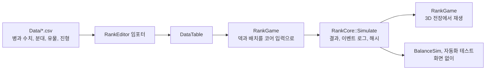

# RANK & FILE

1~4칸 분대를 6×4 진형판에 놓으면 전투가 저절로 진행되는 진형 퍼즐 오토배틀. 해골 군단이 몰려오는 열두 밤 동안 성문을 지킨다.

## 플레이 영상과 스크린샷

## 게임 방법

한 밤은 `보상 → 배치 → 전투 → 결과`로 진행된다. 12번째 밤을 이기면 클리어이고, 패배가 3번 쌓이면 런이 끝난다. 4·8번째 밤은 정예, 12번째 밤은 우두머리가 나온다.

1. 보상: 분대 카드나 유물 3장 가운데 1장을 고른다. 섬멸로 이긴 다음 밤에는 다시 뽑기를 1번 준다.
2. 배치: 분대를 내 진형판(6열 × 4행)에 놓는다. 분대는 1~4칸이 변끼리 붙은 모양이고, 90도씩 돌릴 수만 있다(뒤집기 없음). 밤마다 모든 분대를 다시 놓을 수 있다.
3. 전투: 놓고 나면 열마다 병사들이 빈칸 없이 앞으로 붙어 한 줄(대열)이 되고, 마주 보는 해골의 열과 싸운다. 병과마다 정해진 박자로 공격하고, 앞사람이 쓰러지면 뒷사람이 앞으로 나온다.
4. 결과: 해골을 모두 쓰러뜨리거나(섬멸), 해골 쪽 결계를 부수거나(결계 파괴), 60초를 버티면(새벽) 이긴다. 내 병사가 모두 쓰러지거나 성문이 무너지면 진다.

**링크가 퍼즐의 핵심이다.** 같은 진형판에서 위·아래·왼쪽·오른쪽으로 맞닿은 두 병사의 병과가 다르면 링크가 생기고, 서로 상대 병과가 주는 보너스를 받는다(종류마다 세 겹까지). 어떤 모양의 분대를 어디에 놓아 어떤 병과끼리 붙일지가 매 밤의 문제다.

| 병과 | 공격하는 대상 | 링크로 주는 것 |
|---|---|---|
| 방패병 | 마주 보는 열의 맨 앞 | 방어 +1 |
| 광전사 | 마주 보는 열의 맨 앞 | 공격 +1 |
| 석궁수 | 마주 보는 열의 맨 앞(비면 가까운 열) | 사거리 +1 |
| 마법사 | 왼쪽·가운데·오른쪽 세 열의 맨 앞(방어 무시) | 최대 체력 +5 |
| 척후 | 마주 보는 열의 맨 뒤 | 공격 간격 −1틱 |

해골은 졸개(처음 쓰러지면 한 번 다시 일어선다), 전사, 궁수, 술사 네 종류이고 링크가 없다.

## 주요 기능과 상태

| 기능 | 상태 |
|---|---|
| 결정론 전투 코어: 같은 입력이면 어느 PC, 어느 빌드에서도 같은 결과와 같은 해시 | 구현, 테스트 통과. 기준 확정 전 |
| 링크 계산과 배치 판정(비트마스크) | 구현, 테스트 통과 |
| 특성(분대 카드의 능력, 조각 16개)과 유물 | 규칙 확정, 구현 전 |
| 3D 전투 재생, 배치 화면(3D 전장 위 클릭) | 다음 단계(2단계) |
| 12밤 런, 해골 진형 생성기, 밸런스 시뮬레이터(BalanceSim) | 3~4단계 |
| 첫 밤 튜토리얼 | 예정 |
| 메뉴, 설정, 사운드 | 7단계(마감 품질) |

## 구조

전투 결과를 바꾸는 코드는 `RankCore` 한 곳에만 있다. 게임은 코어가 낸 이벤트 로그를 재생하고, 밸런스 시뮬레이터와 자동화 테스트는 같은 코어를 화면 없이 돌린다.

| 모듈 | 타입 | 맡는 일 | Shipping |
|---|---|---|---|
| `RankCore` | Runtime, 엔진 `Core`만 의존 | 규칙, 전투, 이벤트 로그, 해시, 링크 계산, 배치 판정 | 포함 |
| `RankGame` | Runtime | 런 진행, 전투 재생, UI, 데이터와 코어 구조체의 변환 | 포함 |
| `RankEditor` | Editor | CSV → DataTable 임포터, BalanceSim, 회귀 기록, 해골 진형 생성기 | 제외 |
| `RankTests` | Editor | 자동화 테스트 | 제외 |

- 결정론: 코어는 부동소수점, 순서가 보장되지 않는 컨테이너, 엔진 난수를 쓰지 않는다. 한 틱의 공격은 틱이 시작될 때의 상태로 표적을 정하고 피해를 모아 한꺼번에 준다. 전투 전체를 FNV-1a 32비트 해시 하나로 요약해 비교한다.
- 테스트: 손계산 시나리오(T5, 규칙 문서로 계산한 기대값을 다른 회사 AI 모델이 따로 계산해 교차 검증), 결정성(T2), 미러(T3, 같은 배치를 양쪽에 놓으면 승부가 나지 않는다), 배치 판정 등가성(T4), 회귀(T1, 기준 확정 뒤 대전 20건), Shipping 결정성(T11, 기준 확정 뒤).
- 문서: 전투 규칙 명세 [`docs/rules.md`](docs/rules.md), 설계 [`docs/design.md`](docs/design.md), 결정 기록 [`docs/decisions.md`](docs/decisions.md), 개발 일지 [`docs/devlog/`](docs/devlog/).

## 빌드와 실행

- 필요한 것: Windows, Unreal Engine 5.8.4, Visual Studio 2022 17.14(MSVC 14.44). 엔진 설치 경로를 환경 변수 `UE_ROOT`에 둔다.

| 할 일 | 명령 |
|---|---|
| 에디터 대상 빌드 | `"%UE_ROOT%\Engine\Build\BatchFiles\Build.bat" RankAndFileEditor Win64 Development -Project="<저장소>\RankAndFile.uproject" -WaitMutex` |
| 자동화 테스트 | `tools\run_tests.bat` |
| Shipping 패키지 | `tools\package.bat` |

*에디터에서만 쓰는 AI 도구 플러그인(Unreal MCP 등)은 에디터 대상으로만 켜져 있고 Shipping 패키지에는 들어가지 않는다.

## 검증 기록

| 항목 | 기준 | 결과 | 기록일 |
|---|---|---|---|
| 손계산 시나리오 | 전부 일치 (개수) | 19/19 일치(확인 전 0, 어긋남 0, 형식 오류 0) [측정] (조건은 아래 "자동화 테스트") | 2026-11-22 |
| 회귀 테스트 | 기준 확정 커밋, 20/20 | 아직 없음 | |
| Shipping 결정성 | Shipping 패키지, 20/20 | 아직 없음 | |
| 결정성, 미러 | 각 1,000판 | 결정성 1,000/1,000, 미러 1,000/1,000(Draw 822, Timeout 178) [측정] (조건은 아래 "자동화 테스트") | 2026-11-22 |
| 배치 판정 등가성 | 비트마스크 = 칸 단위, 1만 건 | 10,000/10,000 일치(놓을 수 있음 961, 없음 9,039) [측정] (조건은 아래 "자동화 테스트") | 2026-11-22 |
| BalanceSim 처리량 | 판/초 | 아직 없음 | |
| 관문 통과율 | 후보 수 → 관문 1 → 관문 2 → 채택 | 아직 없음 | |
| 난이도 곡선 | 12밤 중 ±5%p 안인 밤 수 | 아직 없음 | |
| 플레이테스트 | 런 수, 크래시, 이해하지 못한 규칙 수 | 아직 없음 | |
| 프레임 타임 | PC 사양, Test 구성, 장면 | 아직 없음 | |
| 패키지 | 용량, 에디터 없는 PC 실행, 3런 크래시 0회 | 용량: 스테이징 결과 630.5 MB, 파일 30개 [측정] (조건은 아래 "Shipping 패키지"). 에디터 없는 PC 실행: 아직 없음. 3런 크래시 0회: 아직 없음 | 2026-11-20 |

### 자동화 테스트 [측정]

- 명령: `tools\run_tests.bat`
- 빌드 구성: Development Editor, Unreal Engine 5.8.4. 에디터 바이너리는 같은 날 같은 소스로 빌드했다(그 뒤 `Source/` 변경 없음).
- 커밋: `09dadc8`(작업 트리 변경 없음)
- 날짜: 2026-11-22 03:10~03:11
- PC 사양: Intel Core 7 240H, RAM 32GB, Windows 11
- 결과: 실행된 테스트 8개, 통과 7, 실패 1. T5 손계산 시나리오 19/19, T2 결정성 1,000/1,000(시드 200000~200999), T3 미러 1,000/1,000(Draw 822, Timeout 178, 시드 300000~300999), T4 배치 판정 등가성 10,000/10,000(시드 400000~409999), 보조 테스트 3개 통과. T1 회귀 테스트는 "기준 확정 전"으로 실패했다(기준 확정 전에는 이렇게 실패하는 것이 규칙이다).
- 종료 코드: 스크립트 1(T1 실패), 에디터 255. 테스트가 하나라도 실패하면 에디터는 255로 끝난다(-1이 0~255 범위의 수로 바뀐다).
- 손계산 시나리오 19건의 기대값은 다른 회사 모델과의 교차 검증에서 일치했다: run1 18/18(2026-11-20), run2 19/19(2026-11-21). 절차는 `docs/crosscheck/README.md`.

### 빌드 도구 [측정]

에디터 대상(`RankAndFileEditor`), Development, Win64 빌드에서 UnrealBuildTool이 고른 도구와 그 빌드의 결과다.

| 항목 | 값 |
|---|---|
| 엔진 | Unreal Engine 5.8.4 (런처 설치) |
| Visual Studio | Visual Studio 2022 17.14.37411.7 |
| 컴파일러 | MSVC 14.44.35207 (cl 14.44.35228) |
| Windows SDK | 10.0.26100.0 |
| 빌드 결과 | 종료 코드 0, 경고 0, 오류 0, 27/27 단계 |

- 같은 PC에 Visual Studio 2026 18.11(MSVC 14.51)도 설치돼 있었지만 UnrealBuildTool은 쓰지 않았다.
- 빌드 명령에는 UnrealBuildTool 옵션 `-NoHotReloadFromIDE`를 붙였다(에디터가 열려 있어 Live Coding 검사에 막혔기 때문, `docs/devlog/2026-11-19.md`).
- 커밋: 없음(프로젝트 파일을 커밋하기 전의 작업 트리).

### Shipping 패키지 [측정]

- 명령: `tools\package.bat`. `RunUAT.bat BuildCookRun`의 인자는 에디터의 Project Launcher 프로필에서 옮겼다(Shipping, Win64, Pak Files).
- 결과: 종료 코드 0, 걸린 시간 95초, 쿠킹 오류 0·경고 0.
- 스테이징 결과: `Saved/StagedBuilds/Windows`, 파일 30개, 630.5 MB. 큰 파일은 `.pdb` 209.6 MB, 게임 콘텐츠 `.ucas` 186.5 MB, 실행 파일(`.exe`) 158.2 MB.
- 실행 확인: 패키지의 게임을 창 모드로 띄워 20초 동안 응답했고, 닫았을 때 종료 코드 0.
- 커밋: 없음(커밋하지 않은 작업 트리에서 만들었다).

## AI 활용

이 저장소의 코드와 문서는 사람과 AI 코딩 에이전트가 함께 만든다. AI가 따르는 규칙의 전체는 [`AGENTS.md`](AGENTS.md)에 있고, 요점은 아래와 같다.

- 규칙 파일: 루트 `AGENTS.md`가 공통 규칙이고, 폴더마다 `AGENTS.md`가 그 폴더의 규칙을 더한다. AI는 파일을 고치기 전에 그 경로의 규칙 파일을 읽고, 규칙 파일은 임의로 고치지 않는다.
- 다섯 줄 계획: 일을 시작하기 전에 목표, 완료 기준, 검증 명령, 금지, 산출물을 적고 사람의 확인을 받은 기준으로 일한다. 일이 끝나면 검증 명령을 AI가 직접 돌리고 그 출력을 근거로 보고한다.
- 사람이 정하는 것: 전투 규칙과 그 해석, 병과 수치와 규칙 매개변수, 손계산 시나리오의 교차 검증에서 두 계산이 다르거나 모호한 시나리오의 판정, `RankCore`를 기준으로 확정하는 일, 콘텐츠 최종 채택, 재미 판정과 범위. AI는 안을 낼 때 [`docs/decisions.md`](docs/decisions.md)에 "검토 중 · AI 제안"으로 적는다.
- 교차 검증: 손계산 시나리오의 기대값은 AI가 규칙 문서만 보고 계산하고, 다른 회사의 AI 모델이 같은 입력으로 따로 계산해 비교한다. 같은 AI가 같은 문장을 같은 방식으로 잘못 읽는 틀림을 줄이려는 것이다.
- 기준 구현: 사람이 검증을 마친 C++ `RankCore` 커밋.
- 기록: 결정은 [`docs/decisions.md`](docs/decisions.md), 날마다 맡긴 일·사람의 판단·검증·버리거나 고친 AI 산출물은 [`docs/devlog/`](docs/devlog/)에 적는다.

## 크레딧

- 엔진: Unreal Engine 5.8 (Epic Games). 빌드에 쓴 버전은 5.8.4.
- 외부 에셋: 아직 없다. 저장소에 외부에서 가져온 모델, 텍스처, 애니메이션, 사운드, 음악, 글꼴이 없다.
- AI로 만든 에셋: 아직 없다.
- 에셋을 더하면 출처, 저작자, 라이선스와 AI로 만든 것의 범위를 여기에 적는다(`AGENTS.md` 7절).
