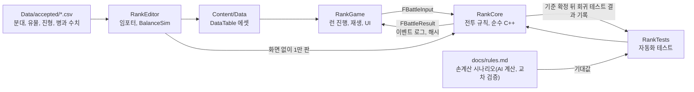
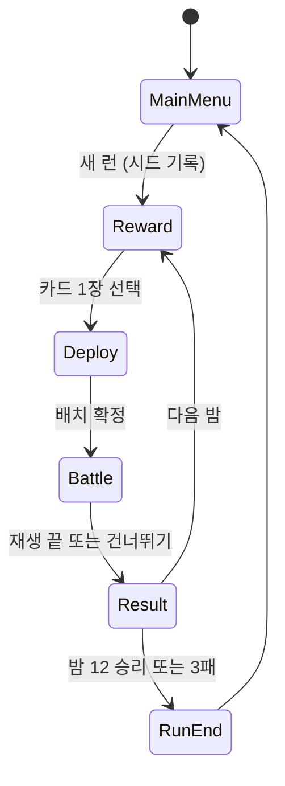
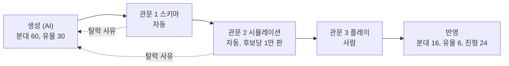
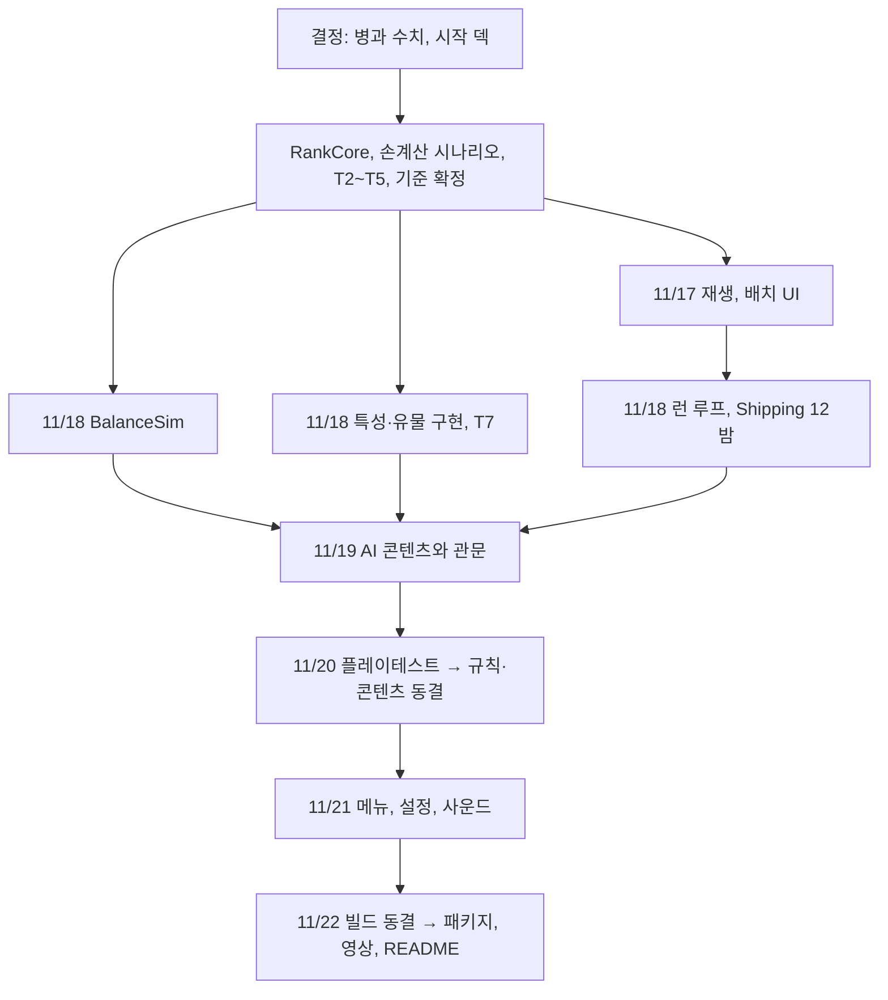

# RANK & FILE 개발 설계도

작성: 2026-11-15, 이 저장소로 옮김: 2026-11-17. 상태: 초안(검토 중 · AI 제안). 제작 전 설계이며 측정 결과가 아니다.

이 문서는 11/16~11/22 제작 주간에 무엇을 어떤 구조로, 어떤 순서로 만들고 어떻게 검증하는지를 한곳에 모은 것이다. 절 번호는 `AGENTS.md`들이 가리키므로 바꾸지 않는다.

| 기준 문서 | 맡는 내용 |
|---|---|
| 기획서 (이 저장소 밖의 기획 문서) | 규칙, 수치, 콘텐츠 분량, 세 관문. 전투 규칙은 `docs/rules.md`로 옮겼다 |
| `rank-and-file-core.js` (이 저장소에 없음) | 기획 단계의 JS 참조 구현. [산정] 수치와 기획서 웹 시뮬레이터의 출처. 11/17부터 C++ 검증의 기준이 아니다(9.0절) |
| 일정표 (이 저장소 밖) | 날짜별 할 일, 판정, 버리는 순서 |
| `docs/balance-2026-11-15.md` | 기획 단계 수치의 문제와 조정안 |

표기
- (기획서 §n): 기획서에서 가져온 내용
- [제안]: 이 문서에서 새로 제안하는 내용. 확정이 아니다
- [미정]: 본인 결정이 필요한 내용. 15절에 모았다
- [미확인]: 확인하지 못한 내용
- 수치 라벨: [초기값] 제작 전 값, [산정] 기획 단계에 JS 참조 구현으로 계산한 값(검증되지 않음), [측정] 게임에서 잰 값

## 1. 한눈에 보기

- 만드는 것: Unreal Engine 5.8(C++)으로 만드는 진형 퍼즐 오토배틀 로그라이트. 1~4칸 분대를 6×4 진형판에 놓으면 전투는 자동으로 진행된다. 12밤, 3패면 런 종료 (기획서 §2, §3)
- 구조의 핵심: 전투 규칙은 `RankCore` 한 곳에만 있다. 게임은 코어가 낸 이벤트 로그를 재생하고, 밸런스 시뮬레이터와 자동화 테스트는 같은 코어를 화면 없이 돌린다 (기획서 §4)
- 결과물: Windows Shipping 패키지, 60~90초 플레이 영상, README

아래 날짜는 11/15에 세운 처음 계획이다. 11/20부터는 날짜가 아니라 표의 순서를 지키고, 완료 기한은 11/22다(루트 `AGENTS.md` 8절).

| 날짜 | 목표 | 그날의 판정 |
|---|---|---|
| 11/16 | 코어 구현과 테스트 | A: 손계산 시나리오 전부, 결정성·미러 각 1,000/1,000, 등가성 10,000/10,000, 본인 리뷰 → 기준 확정과 회귀 테스트 결과 기록 |
| 11/17 | 화면에서 한 판 | B: 배치 → 전투 → 결과가 멈추지 않고 돈다 |
| 11/18 | 한 런과 시뮬레이터 | C: Shipping 빌드로 12밤 완주 |
| 11/19 | AI 콘텐츠 | 12밤 중 10밤 이상이 목표 승률 ±5%p |
| 11/20 | 플레이테스트, 규칙·콘텐츠 동결 | D: 플레이테스트가 끝나면 동결 커밋 |
| 11/21 | 메뉴, 설정, 사운드, 클린 PC | 다른 PC 실행, 프레임 타임 기록. 규칙·콘텐츠 동결 커밋 뒤에 시작 |
| 11/22 | 빌드 동결, 영상, README | E: 마감 품질(11/21 줄)이 끝나면 빌드 동결. 제출할 수 있는 판 1벌 |

## 2. 전제와 범위

확정된 것 (`docs/decisions.md`)
- 엔진: Unreal Engine 5.8(최신 핫픽스), C++ (11/16에 5.6에서 변경)
- 구현: 로직은 C++에만 둔다. UI와 애니메이션은 먼저 C++로 만들고, 세부 조정만 에디터에서 한다(C++ 부모를 둔 위젯 블루프린트와 애니메이션 블루프린트, 이벤트 그래프 없음). 게임 로직용 블루프린트 클래스와 레벨 블루프린트는 쓰지 않는다(11/17 결정 두 건). 방법은 8.7절
- 플랫폼: Windows PC 실행 파일(Shipping 빌드). 판매하지 않는다. 외부에는 플레이 영상과 README 링크로 보여 준다
- 아트: 유닛은 KayKit(CC0) 3D 모델을 쓴다. 배경은 AI로 생성한 이미지로 만든다(11/16 결정. 11/15의 "모듈형 조각으로 조립"을 바꿈)
- 일정: 11/16~11/22 제작, 완료 기한 11/22. 11/20부터 날짜별 일정은 두지 않고 단계 순서를 지킨다. 규칙·콘텐츠 동결은 플레이테스트가 끝나면, 빌드 동결은 마감 품질이 끝나면 반드시 한다(11/20 결정, 루트 `AGENTS.md` 8절). 처음 계획의 시각(11/20 23:59, 11/22 12:00)은 없앴다

완성 정의
1. 에디터가 없는 Windows PC에서 압축을 풀고 exe 하나로 실행된다
2. 처음 하는 사람이 설명 없이 첫 밤을 이긴다(지인 2명)
3. Shipping 빌드로 3런 연속 크래시가 없다
4. 해상도, 창 모드, 음량 설정과 일시정지, 재시작, 메인 메뉴가 있다
5. 결정성·미러·회귀 테스트 통과 기록이 README에 있다
6. 프레임 타임을 PC 사양, 빌드 구성, 장면과 함께 기록했다
7. 크레딧 화면에 에셋 출처가 있고 타인 저작물이 없다

범위 밖: 판매, 현지화, 난이도 단계 해금, 멀티플레이, 컨트롤러, Steam

## 3. 설계 원칙

1. **규칙은 한 곳에만 둔다.** 전투 결과를 바꾸는 코드는 `RankCore`에만 있다. 화면 쪽은 체력을 다시 계산하지 않고 이벤트의 값을 그대로 보여 준다.
2. **코어는 결정론이다.** 정수 연산, 고정 틱, 고정된 순회 순서, 한 틱의 행동은 모아서 한꺼번에 적용, 전투 안에는 난수가 없다 (기획서 §4).
3. **콘텐츠는 데이터다.** 분대, 유물, 해골 진형, 병과 수치는 CSV에서 온다(11/18 JSON에서 변경). 코드는 정해진 어휘 조각만 구현한다 (기획서 §3).
4. **확인할 수 있는 것만 AI에게 맡긴다.** 모든 작업은 완료 기준과 검증 명령을 먼저 적고 시작한다 (기획서 §6).

## 4. 전체 구조

### 4.1 모듈



| 모듈 | 타입 | 의존 | 맡는 일 | Shipping 포함 |
|---|---|---|---|---|
| `RankCore` | Runtime | 엔진 Core만 | 규칙, 전투, 이벤트 로그, 해시, 링크 계산, 배치 판정 | 포함 |
| `RankGame` | Runtime | RankCore | 런 진행, 전투 재생, UI, 설정, DataTable 행 구조체와 코어 구조체 변환 | 포함 |
| `RankEditor` | Editor | RankCore, RankGame | CSV → DataTable 임포터, BalanceSim·RankRegression 커맨들릿(commandlet) | 제외 |
| `RankTests` | Editor | RankCore, RankGame | 자동화 테스트 | 제외 |

- 모듈 4개와 그 역할은 기획서 §4를 따른다.
- `RankEditor`와 `RankTests`는 `RankGame`에도 의존한다(만들어 둠: `RankAndFile.uproject`, `RankTests.Build.cs`, `RankEditor.Build.cs`). 이유: `RankCore`는 UObject를 쓰지 않으므로 DataTable 행 구조체(USTRUCT)를 둘 수 없다. 행 구조체와 "행 → 코어 구조체" 변환 함수를 `RankGame`에 하나만 두고, 게임, 임포터, 시뮬레이터가 같은 함수를 쓴다.
- Editor 타입 모듈은 런타임 빌드에 컴파일되지 않는다([Epic: Unreal Engine Modules](https://dev.epicgames.com/documentation/en-us/unreal-engine/unreal-engine-modules)). 테스트와 시뮬레이터를 Shipping 패키지에서 빼는 근거다.

### 4.2 경계 규칙

| 규칙 | 이유 |
|---|---|
| `RankCore`는 UObject, UWorld, 엔진 난수, float을 쓰지 않는다 | 결정론과 화면 없는 실행 |
| `RankGame`은 전투 결과를 계산하지 않는다. 배치 화면의 링크 미리보기도 `RankCore` 함수를 부른다 | 화면과 시뮬레이터가 다른 답을 내지 않게 한다 |
| 콘텐츠를 읽는 경로는 하나다: CSV → 행 구조체 → 코어 구조체 | 게임과 시뮬레이터가 다른 데이터를 보지 않게 한다 |
| 수치는 코드에 적지 않는다. 병과 수치와 규칙 매개변수도 데이터다 | 밸런스 조정 때 코드를 고치지 않는다 |

### 4.3 한 밤의 데이터 흐름

1. `URunSubsystem`이 덱, 배치, 그 밤의 해골 진형을 `FBattleInput`으로 묶는다.
2. `Rank::Simulate(Input)`이 `FBattleResult`(결과, 틱, 해시, 이벤트 로그)를 돌려준다. 여기서 승패가 정해진다.
3. `UBattleReplayer`가 이벤트 로그를 시간 순서로 재생한다. 2배속과 건너뛰기는 재생 속도만 바꾼다.
4. 재생이 끝나면 결과 화면이 같은 `FBattleResult`로 열별 요약을 보여 준다.

## 5. 저장소 구조 (게임 저장소) [제안]

이 저장소의 구조다.

```
rank-and-file/
├─ RankAndFile.uproject
├─ AGENTS.md                  AI 작업 규칙: 완료 기준, 금지 사항, 검증 명령
├─ README.md                  게임 소개, 구조, 빌드, 검증 기록, AI 활용, 크레딧
├─ docs/
│  ├─ design.md               이 문서
│  ├─ rules.md                전투 규칙 8조항 (기획서 §2)
│  ├─ decisions.md            결정 기록: 날짜, 결정, 대안, 근거, 상태
│  └─ devlog/2026-11-16.md    개발 일지 4칸
├─ tools/
│  ├─ record_regression.bat       기준으로 확정된 RankCore로 회귀 테스트 결과 기록
│  ├─ validate_content.js     관문 1 스키마 검사
│  ├─ run_tests.bat           테스트 한 줄 실행
│  ├─ run_sim.bat             BalanceSim 실행
│  ├─ package.bat             Shipping 패키지
│  └─ check_shipping_determinism.bat  Shipping 패키지로 회귀 테스트 입력을 돌려 기록과 비교(T11)
├─ Data/
│  ├─ defs/units.csv, rules.csv        병과 수치, 규칙 매개변수
│  ├─ candidates/round1/               AI가 낸 후보
│  ├─ accepted/squads.csv, relics.csv, formations.csv
│  └─ reports/                         관문 기록, BalanceSim CSV
├─ Content/
│  ├─ Data/                   DataTable 에셋
│  ├─ Characters/             KayKit 9종
│  ├─ Environment/            전장 조각
│  ├─ UI/, Audio/
│  └─ Maps/L_Field.umap
└─ Source/
   ├─ RankCore/
   ├─ RankGame/
   ├─ RankEditor/
   └─ RankTests/Fixtures/hand_v1.json, regression_branches.csv, regression_inputs.csv, regression_battles_v1.json
```

11/16 추가: `AGENTS.md`는 루트 말고도 `docs/`, `tools/`, `Data/`, `Content/`, `Source/`와 모듈 4개 폴더에 하나씩 둔다(모두 10개). 루트 파일이 공통 규칙이고 하위 파일은 그 폴더의 규칙만 더한다. Claude Code는 `CLAUDE.md`가 없는 저장소에서 `AGENTS.md`를 프로젝트 지침으로 읽고, 하위 폴더의 것은 그 폴더의 파일을 Read 도구로 열 때 불러온다([Claude Code Docs: memory](https://code.claude.com/docs/en/memory)). 그래서 루트 규칙에 "만들거나 고치기 전에 직접 읽는다"를 넣었다.

## 6. RankCore 상세

### 6.1 공개 형태 [제안]

```cpp
namespace Rank
{
    struct FUnitDef    { uint8 Key; int32 Hp, Atk, Armor, Interval, Range; ETarget Target; bool bMagic; int32 Revive; ELinkStat Link; int32 LinkAmount; };
    struct FRuleParams { int32 MaxTicks, GateHp, Breach, LinkStackMax, RangeMax, IntervalMin; bool bLinks = true; };  // 값은 Data/defs/rules.csv에서 채운다. 코드에 기본값을 두지 않는다
    struct FFormation  { uint8 Cells[4][6]; };                 // 칸마다 병과 키, 빈칸은 0. 행 0이 최전열
    struct FBattleInput{ FFormation Side[2]; FRuleParams Rules; const FUnitDef* Defs; int32 NumDefs; };
    struct FBattleEvent{ int32 Tick; uint8 Type; int32 Actor; int32 Target; int32 Value; };
    struct FBattleResult
    {
        EOutcome Outcome;            // A, B, Draw, Timeout, Invalid(입력 오류, rules.md §3.6)
        int32 Tick; uint32 Hash; int32 NumEvents; int32 Gate[2];
        int32 Alive[2]; int32 HpSum[2];
        TArray<FBattleEvent> Log;    // 기록 옵션을 켰을 때만 채운다
    };

    FBattleResult Simulate(const FBattleInput& In, bool bRecordLog);
    FLinkBonus    ComputeLinks(const FFormation& F, int32 Row, int32 Col);   // 배치 화면도 이 함수를 쓴다
    FVerdict      Judge(const FBattleResult& R);                             // 플레이어 기준 승패와 종류
}
```

`Simulate`는 입력만으로 결과가 정해지는 함수다. 전역 상태를 읽거나 쓰지 않는다.

- 특성과 유물(`docs/rules.md` §10)을 위해 더할 것 [제안]: 칸마다 분대 번호, 분대마다 특성(언제·무엇·누구·N·L), 진영 0의 유물 목록, 진영마다 규칙 매개변수(유물이 진영 0의 값만 바꾼다), 유닛마다 보호막, 이벤트 종류 5~11. 구현은 기준 확정 뒤에 하고, 공개 형태가 바뀌므로 구현 전에 알린다(`Source/RankCore/AGENTS.md`).

### 6.2 병과와 규칙 매개변수 [초기값]

11/17에 `docs/balance-2026-11-15.md` 3절의 조정안을 채택했다(확정 · 본인). 척후 간격 8 → 9, 체력 20 → 18, 석궁수 공격 3 → 4, 마법사 공격 2 → 3. 아래 표는 조정 뒤 값이고, 기준은 `docs/rules.md` §7과 `Data/defs/`다.

| 키 | 이름 | 체력 | 공격 | 방어 | 간격(틱) | 사거리 | 표적 | 기타 | 링크로 주는 것 |
|---|---|---|---|---|---|---|---|---|---|
| K | 방패병 | 40 | 2 | 1 | 10 | 1 | 맨 앞 | | 방어 +1 |
| B | 광전사 | 28 | 5 | 0 | 10 | 1 | 맨 앞 | | 공격 +1 |
| R | 석궁수 | 16 | 4 | 0 | 12 | 3 | 지원 | | 사거리 +1 |
| M | 마법사 | 14 | 3 | 0 | 16 | 4 | 범위 | 마법 | 최대 체력 +5 |
| H | 척후 | 18 | 3 | 0 | 9 | 2 | 맨 뒤 | | 간격 −1틱 |
| m | 해골 졸개 | 12 | 2 | 0 | 10 | 1 | 맨 앞 | 부활 6 | 없음 |
| w | 해골 전사 | 32 | 3 | 1 | 12 | 1 | 맨 앞 | | 없음 |
| r | 해골 궁수 | 16 | 3 | 0 | 12 | 3 | 지원 | | 없음 |
| g | 해골 술사 | 16 | 2 | 0 | 18 | 4 | 범위 | 마법 | 없음 |

규칙 매개변수: 최대 600틱(1틱 = 0.1초), 성문과 결계 60, 성문 피해 1, 링크 겹 상한 3, 사거리 상한 4, 간격 하한 4. 뒤의 셋은 11/18에 규칙 문장에서 데이터로 옮겼다(값은 그대로, `docs/rules.md` §9 14번). 진형판 6열 × 4행은 매개변수가 아니라 규칙 상수다(11/20, `docs/rules.md` §9 18번).

### 6.3 유닛 생성과 링크

아래 순서와 식은 `docs/rules.md`에 조항으로 옮겨 구현의 기준으로 쓴다. 참조 구현에서 읽어 낸 것이라 [제안]이었고, 11/18 `docs/rules.md` 확정(확정 · 본인)으로 기준은 `docs/rules.md`가 됐다. 둘이 다르면 `docs/rules.md`를 따른다.

1. 진영 0(플레이어) → 1(해골), 행 0 → 3, 열 0 → 5 순서로 칸을 훑어 유닛을 만든다.
2. 유닛 번호 = 진영 × 100 + 행 × 6 + 열. 이 번호가 해시에 들어간다.
3. 유닛은 자기 열의 대열 뒤에 붙는다. 행 0이 대열 맨 앞이다. 빈칸은 대열에서 사라진다 (기획서 §2.3).
4. 링크: 상하좌우 이웃의 병과가 다르고 그 병과에 링크 효과가 있으면 그 효과를 한 겹 받는다. 해골은 링크 효과가 없으므로 링크를 주지도 받지도 않는다. 링크는 병과로만 정하고 진영은 보지 않는다(11/18, `docs/rules.md` §3.3).
5. 최종 능력치 (11/18: 한 겹의 크기 a와 상한·하한을 데이터에서 읽는다. n은 받은 겹 수)

| 능력치 | 식 |
|---|---|
| 방어 | 기본 + a × min(n, 겹 상한) |
| 공격 | 기본 + a × min(n, 겹 상한) |
| 사거리 | min(기본 + a × min(n, 겹 상한), 사거리 상한) |
| 최대 체력 | 기본 + a × min(n, 겹 상한) |
| 간격 | max(기본 + a × min(n, 겹 상한), 간격 하한) |

6. 대기 시간(cd)의 처음 값은 간격이다. 첫 공격은 간격 번째 틱에 나간다.

### 6.4 한 틱의 처리 순서

틱은 1부터 600까지 돈다.

| 단계 | 처리 |
|---|---|
| ① 의도 수집 | 진영 0 → 1, 열 0 → 5, 대열 앞 → 뒤 순서. cd가 0보다 크면 1 줄인다. cd가 아직 0보다 크거나 대열 순번이 사거리 이상이면 건너뛴다(cd는 0에 머문다: 준비된 채 대기). 아니면 표적을 고르고 cd를 간격으로 되돌린다 |
| ② 의도 없음 | 이번 틱에 의도가 하나도 없으면 ③~⑤를 건너뛴다 |
| ③ 적용 | 수집한 순서대로 적용한다. 표적은 ①에서 고른 것을 바꾸지 않는다. 이미 체력이 0 이하가 된 표적에도 그대로 적용한다. 기록하는 피해는 계산한 값 그대로이고, 체력과 성문은 0 아래로도 내려간다(11/18) |
| ④ 사망 정리 | 진영 0 → 1, 열 0 → 5, 대열 앞 → 뒤 순서. 체력이 0 이하이고 부활 값이 있으면 체력을 그 값으로 바꾸고 부활 값을 0으로 한다(자리는 그대로). 부활 값이 없으면 대열에서 뺀다. 뒤의 유닛이 앞으로 당겨지고, 당겨진 유닛의 cd는 그대로다(11/18) |
| ⑤ 판정 | 한쪽의 성문이 0 이하이거나 모든 열이 비면 그쪽이 진 것이다. 양쪽이 같은 틱에 지면 무승부다 |

600틱까지 끝나지 않으면 시간 초과(Timeout)이고 틱은 600으로 기록한다.

표적 (기획서 §2.5)

| 표적 | 고르는 법 |
|---|---|
| 맨 앞 | 마주 보는 열의 맨 앞. 열이 비면 상대 성문 |
| 맨 뒤 | 마주 보는 열의 맨 뒤. 열이 비면 상대 성문 |
| 지원 | 마주 보는 열의 맨 앞. 비면 거리 1부터 5까지, 같은 거리에서는 왼쪽 열을 먼저 본다. 모두 비면 상대 성문 |
| 범위 | 왼쪽, 가운데, 오른쪽 세 열의 맨 앞을 열 번호 순서로 모두. 진형판 밖의 열은 빈 열로 본다. 셋 다 비면 상대 성문을 한 번 |

피해 (기획서 §2.6): 마법은 공격 값 그대로, 물리는 max(1, 공격 − 방어), 성문은 성문 피해 값(1).

플레이어 기준 판정 (`verdict`)

| 코어 결과 | 판정 |
|---|---|
| A 승 | 승리. 결계가 0 이하면 '결계 파괴', 아니면 '섬멸' |
| Timeout | 승리 '새벽' |
| Draw | 성문이 남아 있으면 승리 '성문 사수', 아니면 패배 |
| B 승 | 패배. 성문이 0 이하면 '성문 붕괴', 아니면 '전멸' |

### 6.5 이벤트와 해시

해시는 FNV-1a 32비트다. 시작값 `0x811c9dc5`, 곱하는 수 `0x01000193`. 정수 하나를 섞을 때는 하위 바이트부터 4바이트를 차례로 XOR하고 곱한다. C++에서는 `uint32` 곱셈을 그대로 쓴다.

| 이벤트 | 종류 값 | 해시에 섞는 순서 |
|---|---|---|
| 성문 타격 | 1 | 틱, 1, 공격자 번호, 999, 피해 |
| 피해 | 2 | 틱, 2, 공격자 번호, 표적 번호, 피해 |
| 부활 | 3 | 틱, 3, 유닛 번호 |
| 사망 | 4 | 틱, 4, 유닛 번호 |
| 종료 | | 마지막 틱, 결과 코드(A 1, B 2, Draw 3, Timeout 4) |

이벤트 로그의 항목도 같은 종류 값과 필드를 쓴다. 재생기와 디버깅이 같은 로그를 본다.

11/18: 로그 한 줄은 틱, 종류, 행위자, 표적, 값이다. 부활은 유닛 번호, 유닛 번호, 부활한 뒤의 체력, 사망은 유닛 번호, 유닛 번호, 0을 적는다. 종료는 로그와 이벤트 수에 넣지 않고 해시에만 섞는다. 이벤트 수는 종류 1~4인 로그 줄의 개수다(`docs/rules.md` §6).

### 6.6 결정론 점검표 (코드 리뷰 기준)

기획서 §4의 결정론 규칙 다섯을 리뷰에서 확인할 수 있는 항목으로 풀었다.

- [ ] `RankCore`에 float, double이 없다
- [ ] 순서가 보장되지 않는 컨테이너를 순회하지 않는다. 배열과 고정 순서만 쓴다
- [ ] 포인터 주소로 비교하거나 정렬하지 않는다
- [ ] 초기화하지 않은 멤버가 없다
- [ ] 전역 변수와 정적 변수에 상태를 두지 않는다
- [ ] 한 틱 안에서 표적 선택은 틱 시작 상태만 본다
- [ ] 엔진 난수 함수를 부르지 않는다

### 6.7 배치 판정

`FFormationMask`는 행마다 비트 6개로 점유를 표시하고, 한 행을 AND 한 번으로 검사한다 (기획서 §4). 같은 판정을 배치 UI와 탐색 봇이 함께 쓴다. 칸 단위로 단순하게 짠 구현과 결과가 같은지 무작위 1만 건으로 대조한다. EXFIL에서 쓴 등가성 검증 방식이다(90케이스 Before == After 90/90 [측정], [EXFIL 벤치마크 문서](https://github.com/agnesAqr/project_EXFIL/blob/main/docs/Benchmarks/GridInventoryBitmap.md)).

### 6.8 특성과 유물 (11/22 확정)

처리 시점, 조각, 대상, 이벤트는 `docs/rules.md` §10이 기준이다(2026-11-22 결정). 이 절은 구현 계획만 적는다.

- 조각 16개(언제 5, 무엇 6, 누구 5)를 모두 구현한다(11/21 결정 3 ①, 범위 축소에서 줄이지 않음). 데이터 식별자와 형식은 `Data/AGENTS.md`의 분대(`trait*`)와 유물(`effect*`)이다.
- 구현은 기준 확정 뒤에 한다(11/22 결정). 코어 입력에 더할 것은 6.1의 [제안]이다.
- 검증: 조각마다 AI가 §10으로 계산하고 교차 검증한 예제를 2개 이상 둔다(T7). 특성이 들어간 덱으로 결정성과 미러 테스트를 다시 돌린다(유물은 진영 0에만 쓰므로 미러에 넣지 않는다). 특성과 유물이 없는 전투의 결과와 해시는 그대로여야 한다(T1).
- 11/21까지의 제안 표는 §10으로 바뀌었다. 효과 이벤트는 종류 하나(5)가 아니라 효과마다 5~11이고(§10.8), 최대 틱을 바꾸는 유물은 만들지 않는다(11/21 결정 3 ⑦).

## 7. 콘텐츠 데이터

### 7.1 종류와 분량 (기획서 §3)

| 종류 | 출시 목표 | 후보 수 | 파일 |
|---|---|---|---|
| 분대 카드 | 16 | 60 | `accepted/squads.csv` |
| 유물 | 6 | 30 | `accepted/relics.csv` |
| 해골 진형 | 24 (밤마다 2개) | 생성기가 만든다(후보 수는 생성기 인자) | `accepted/formations.csv` |
| 병과 수치 | 9 | | `defs/units.csv` |
| 규칙 매개변수 | 1 | | `defs/rules.csv` |

출시 목표는 11/21 범위 축소와 결정 3 ⑥으로 바꿨다. 해골 진형은 AI가 만들지 않고 `RankEditor`의 생성기가 만든다(11/20 결정).

### 7.2 형식

11/18 결정으로 모두 CSV다. 공통 규칙(UTF-8, 첫 줄 열 이름, 쉼표 구분)과 열 설명은 `Data/AGENTS.md`의 "형식" 절이 기준이다.

분대 (기획서 §5의 예시를 CSV로 편 것)

```csv
id,name,class,shape,tier,traitWhen,traitDo,traitWho,traitN,traitLimit
sq_K_L3_02,성벽 방패대,K,0:0;1:0;1:1,2,OnHit,Shield,Linked,2,3
```

해골 진형

```csv
id,night,kind,row0,row1,row2,row3
fm_n07_a,7,normal,wwmmww,mrmmrm,.g..g.,..rr..
```

유물

```csv
id,name,effectKind,effectParam,effectDelta,effectTarget
rl_iron_gate,철문,Rule,GateHp,10,
rl_war_drum,전쟁 북,Start,AtkUp,1,B
```

카드 설명문은 데이터에 넣지 않는다. 조각에서 템플릿으로 만든다 (기획서 §5). 예: "맞을 때 링크된 이웃에게 보호막 2 (전투당 3회)".

### 7.3 게임에 들어가는 경로

1. `tools/validate_content.js`가 관문 1을 검사한다(10절).
2. `RankEditor`의 임포터가 `Data/accepted/*.csv`를 DataTable 에셋으로 바꾼다. CSV는 `RankGame`의 읽기 함수로 행 구조체로 읽고, 행을 `UDataTable::AddRow`로 넣는다. 엔진 CSV 임포트는 쓰지 않는다(11/21 결정 4 ④: 첫 열과 열 이름을 구조체에 맞춰야 하고 읽는 경로가 둘이 된다). `AddRow`는 문제 메시지를 돌려주지 않고 같은 행 이름을 경고 없이 덮어쓰므로(5.8.4 `Engine/Source/Runtime/Engine/Private/DataTable.cpp:519-560`), 임포터가 읽기 함수의 오류와 id 겹침(행 이름 `FName`은 대소문자를 가리지 않는다)을 모아 하나라도 있으면 저장하지 않고 실패로 처리한다. 저장한 테이블의 행 수가 CSV 항목 수와 같은지는 T8이 본다. `defs`의 두 파일은 CSV 줄 번호를 행 이름으로 쓴다(11/22 결정).
3. 분대 모양은 `0:0;1:0;1:1` 같은 문자열 한 칸이다. 칸 목록으로 바꾸는 일은 `RankGame`의 변환 함수가 맡는다(11/18 CSV로 바꾸며 "배열 안의 배열" 문제가 없어졌다).
4. 콘텐츠 버전 해시: 채택본 CSV 3개와 `defs` CSV 2개의 내용을, BOM을 빼고 줄바꿈을 LF로 맞춘 뒤 FNV-1a로 묶은 값을 빌드에 넣고 결과 화면과 README에 적는다 (기획서 §5). 어느 콘텐츠로 잰 수치인지 구분하는 데 쓴다.
5. 입력 오류를 읽을 때 막는다(11/20 결정, `docs/rules.md` §3.6): `formations.csv`를 읽을 때 병과 수치(`defs/units.csv`)에 없는 병과 키가 있거나 병사가 한 명도 없는 진형은 읽기 실패로 처리한다. 이 검사는 `formations.csv`를 읽는 쪽(아직 없다)에 두고 `RankContent::ParseFormationRows`에는 두지 않는다. 손계산 시나리오가 그 함수로 모르는 병과 키를 읽어 코어의 §3.6을 확인하기 때문이다.

## 8. RankGame 상세

### 8.1 런 진행



- 한 밤은 보상 → 배치 → 전투 → 결과다. 보상은 분대나 유물 3장 중 1장이고, 섬멸로 이긴 다음 밤에는 다시 뽑기를 1번 준다 (기획서 §3).
- 4·8번째 밤은 정예, 12번째 밤은 우두머리다. 패배가 3번 쌓이면 런이 끝난다 (기획서 §3).
- 시작 덱 [초기값]: 분대 3개(병사 5~6명), 밤마다 보상 3장 가운데 1장, 분대와 유물 2:1, 기대 덱 밤 3 약 6명·밤 7 약 10명·밤 12 약 12명. BalanceSim으로 잰 뒤 다시 정한다(11/21 결정 3 ⑤).
- 입력 오류(`docs/rules.md` §3.6)는 판정하지 않으므로(§5.2) 패배로 세지 않는다(11/20 결정). `Rank::Judge`의 `bJudged`가 false면 `bWin`을 보지 않는다. 아군 진형판이 비는 경우는 배치 화면이 막고(8.3절), 모르는 병과 키와 빈 해골 진형은 `formations.csv`를 읽을 때 막는다(7.3절).
- 그래도 런 중에 해골 진형판이 비어 있으면 그 밤의 다른 진형으로 바꿔 다시 시작한다. 1번 바꿔도 안 되면 오류를 UI로 알리고 게임을 끝낸다(11/20 결정, 11/21 바꿈: 2번 → 1번). 11/21 범위 축소로 해골 진형이 24개라 밤마다 진형이 2개이고, 그래서 1번까지 바꿀 수 있다.

`URunSubsystem` [제안]: `UGameInstanceSubsystem`으로 만든다. 게임 인스턴스와 수명이 같고 인스턴스가 초기화될 때 `Initialize()`가 불린다([Epic: Programming Subsystems](https://dev.epicgames.com/documentation/en-us/unreal-engine/programming-subsystems-in-unreal-engine)). 레벨을 바꿔도 런 상태가 남는다.

| 가진 것 | 내용 |
|---|---|
| `FRunState` | 시드, 난수 상태, 밤, 패배 수, 덱, 유물, 직전 배치, 선택 이력, 콘텐츠 버전 해시 |
| 난수 | 런 레이어 전용 정수 난수기. 보상 카드와 해골 진형 선택에만 쓴다 (기획서 §4). 상태를 `FRunState`에 둔다 |
| 하지 않는 것 | 전투 계산. `Rank::Simulate`를 부르고 결과를 보관할 뿐이다 |

시드와 선택 이력만 있으면 런 전체를 다시 만들 수 있다. 버그 재현이 이 성질을 쓴다. 저장과 이어하기는 만들지 않는다(11/21 범위 축소).

### 8.2 전투 재생

| 항목 | 설계 |
|---|---|
| 입력 | `FBattleResult.Log`와 전투 시작 배치 |
| 시간 | 1틱 = 0.1초 (기획서 §2.4). 1배속, 2배속, 건너뛰기 (기획서 §3) |
| 유닛 | 유닛마다 액터 1개(스켈레탈 메시). 위치는 열과 대열 순번에서 정한다. 대열 전진만 보간한다. float은 여기서만 쓴다 |
| 체력 | 재생기가 계산하지 않는다. 이벤트의 값을 빼서 표시한다 |
| 일시정지 | 재생 시계를 멈춘다 |
| 애니메이션 | 먼저 `USkeletalMeshComponent::PlayAnimation`으로 이벤트마다 시퀀스를 직접 재생한다. 5.8.4에서 이 함수는 메시를 단일 노드 모드로 바꾸고 시퀀스를 바로 바꾼다(섞는 시간 인자가 없다, `Engine/Source/Runtime/Engine/Private/Components/SkeletalMeshComponent.cpp:4278-4289`). BeginPlay 뒤에 부른다(생성 스크립트에서 부르지 말라는 엔진 주석, `SkeletalMeshComponent.h:1251-1255`). 블렌딩 조정은 시간이 남으면 하는 항목이다(11/21 범위 축소). 그때 본인이 C++ `UAnimInstance` 하위 클래스를 부모로 한 애니메이션 블루프린트를 에디터에서 만든다(11/21 AI 기능 결정 ⑤). 상태 값은 C++이 정하고 블루프린트에는 애니메이션 그래프만 둔다. [미정] 끊김이 거슬리는지는 본인이 첫 재생 화면을 보고 정한다 |
| 확인 [제안] | 재생이 끝났을 때 화면의 생존 수와 성문 값이 `FBattleResult`와 같은지 개발 빌드에서 검사한다 |

이벤트와 애니메이션 (기획서 §4, GLB에서 이름 확인)

| 유닛 | 공격 | 피격 | 쓰러짐 |
|---|---|---|---|
| 방패병 `Knight` | `1H_Melee_Attack_Chop` | `Block_Hit` | `Death_A` |
| 광전사 `Barbarian` | `2H_Melee_Attack_Chop` | `Hit_A` | `Death_B` |
| 석궁수 `Rogue` | `2H_Ranged_Shoot` | `Hit_A` | `Death_A` |
| 마법사 `Mage` | `Spellcast_Shoot` | `Hit_B` | `Death_B` |
| 척후 `Rogue_Hooded` | `Dualwield_Melee_Attack_Stab` | `Hit_B` | `Death_A` |
| 해골 졸개 | `1H_Melee_Attack_Chop` | `Hit_A` | `Death_C_Skeletons`, 부활 `Death_C_Skeletons_Resurrect` |
| 해골 전사 | `1H_Melee_Attack_Slice_Horizontal` | `Block_Hit` | `Death_A` |
| 해골 궁수 | `2H_Ranged_Shoot` | `Hit_A` | `Death_B` |
| 해골 술사 | `Spellcast_Shoot` | `Hit_B` | `Death_B` |

해골 등장은 `Spawn_Ground_Skeletons`, 아군 승리는 `Cheer`다. 대기는 `Idle_Combat`, 전진은 아군 `Walking_A`, 해골 `Walking_D_Skeletons`다(11/21 결정 4 ②).

### 8.3 배치 화면

- 6×4 진형판, 분대를 고르고 3D 전장의 칸을 클릭해 놓기(클릭 배치), 회전(R), 링크 표시(11/21 범위 축소, 결정 3 ③).
- 놓을 수 있는지는 `FFormationMask::CanPlace`, 링크와 최종 능력치 미리보기는 `Rank::ComputeLinks`로 계산한다.
- 병사를 한 명도 놓지 않으면 전투 시작 버튼을 누를 수 없게 한다(11/18, `docs/rules.md` §3.6). 분대는 돌리기만 하고 뒤집지 않는다(§2.1).
- 아군 진형판이 빈 채로 전투를 시작하려 하면 경고 UI로 알리고 전투를 시작하지 않는다. 패배로 세지 않는다(11/20 결정).
- 입력은 3D 전장 위 클릭이다(11/21 결정 3 ③, AI 권장안은 격자 위젯이었다). 화면 좌표를 칸으로 바꾸는 코드는 한 곳에 둔다.
- 배치 화면에서 그 밤의 해골 진형을 모두 보여 준다(11/21 결정 3 ②).
- 배치에 1분 넘게 걸리면 우클릭·휠 회전과 직전 배치 불러오기를 넣는다 (기획서 §8).

### 8.4 화면과 UI 구조

| 화면 | 보여 주는 것 | 뷰모델 [제안] |
|---|---|---|
| 메인 메뉴 | 새 런, 설정, 크레딧, 종료 | |
| 보상 | 카드 3장, 12밤 진행 표시, 남은 패배 허용 | `RewardVM`, `RunVM` |
| 배치 | 진형판, 보유 분대, 링크, 병사 능력치 | `DeployVM` |
| 전투 | 성문과 결계, 시계, 배속, 건너뛰기 | `BattleVM` |
| 결과 | 승패와 종류, 열별 요약 | `ResultVM` |
| 런 종료 | 클리어 또는 실패, 시드, 콘텐츠 버전 | `RunVM` |
| 일시정지, 설정, 크레딧 | 해상도, 창 모드, 음량, 에셋 출처 | |
| 첫 밤 튜토리얼 | 배치와 링크 안내 | |

- UI는 MVVM으로 나눈다 (기획서 §4). EXFIL에서 같은 구조를 썼다.
- 뷰모델은 C++ 클래스이고 값이 바뀌면 델리게이트로 알린다. UMG Viewmodel 플러그인은 쓰지 않는다. 기획서 §8의 플러그인 최소화와 맞다(11/17).
- 위젯의 동작(입력 처리, 뷰모델 연결, 표시 갱신)은 C++ `UUserWidget` 하위 클래스에 둔다. 배치, 글꼴, 색, 크기는 그 클래스를 부모로 한 위젯 블루프린트에서 조정하고, C++은 `meta=(BindWidget)`으로 이름이 같은 위젯을 받는다. 위젯 블루프린트의 이벤트 그래프는 비워 둔다(11/17). `BindWidget`의 5.8.4 동작은 엔진 소스로 확인했다(11/21): 위젯 블루프린트 컴파일러가 이름과 형을 검사해 없으면 오류를 내고(`Engine/Source/Editor/UMGEditor/Private/WidgetBlueprintCompiler.cpp:1257-1305`), 실행 중에는 이름이 같은 속성에 위젯을 넣는다(`Engine/Source/Runtime/UMG/Private/WidgetBlueprintGeneratedClass.cpp:270-277`). 상세는 `docs/review/unconfirmed-check-2026-11-21.md` 1번.
- 위젯 배치는 처음부터 위젯 블루프린트 디자이너에서 한다. 위젯 블루프린트는 AI가 MCP(UMG ToolSet)로 만들고, 본인이 캡처를 보고 받아들인다(11/21 결정 3 ④).
- [제안] 레벨은 `L_Field` 하나만 둔다. 메뉴와 각 화면은 같은 전장 위에 UI로 띄운다. 레벨 전환과 쿠킹 대상이 줄어든다.

### 8.5 설정, 사운드, 저장

- 해상도와 창 모드는 `UGameUserSettings`의 `SetScreenResolution`, `SetFullscreenMode`로 정하고 `ApplySettings`로 적용·저장한다([Epic API: UGameUserSettings](https://dev.epicgames.com/documentation/en-us/unreal-engine/API/Runtime/Engine/UGameUserSettings)).
- 음량은 마스터 하나만 둔다 [제안].
- 사운드는 이벤트 종류마다 하나씩 붙인다(공격, 피격, 쓰러짐, 부활, 성문 타격, 승리, 패배). 사운드 팩의 내용과 라이선스는 아직 확인하지 않았다 (기획서 §9). 사운드는 최소로 한다(11/21 범위 축소).
- 저장과 이어하기는 만들지 않는다(11/21 범위 축소).

### 8.6 에셋

| 대상 | 계획 | 확인할 것 |
|---|---|---|
| 캐릭터 9종 | KayKit Adventurers 5종, Skeletons 4종. Skeleton 에셋 하나를 함께 쓴다. 재생은 C++이 먼저 하고, 블렌딩 조정은 시간이 남으면 본인이 C++ 부모를 둔 애니메이션 블루프린트 하나를 만들어 9종이 함께 쓴다 | 9종 받음(11/21). 관절 41개의 이름과 순서가 같다 [측정: 11/21, GLB JSON 청크]. 임포트는 본인이 임포트 창에서 한다 |
| 배경 | [보류, 11/21] AI로 생성한 이미지 3장(아군 쪽 바닥 타일, 적 쪽 바닥 타일, 원경). 기준은 `docs/background.md`, 아래 "배경" 항목은 첫 안 | 11/16 생성. 유닛과 화풍이 맞는지, 진형이 읽히는지 |
| 가장자리 소품(선택) | Halloween Bits와 Dungeon Remastered의 조각 몇 개로 깊이감을 보탠다 | 호박 같은 계절 소품은 뺀다 (기획서 §9) |

- 임포트할 때 Skeleton 항목에 기존 Skeleton을 지정하면 그 Skeleton을 쓰고, 비워 두면 새로 만든다([Epic: Interchange Import Reference](https://dev.epicgames.com/documentation/unreal-engine/interchange-import-reference-in-unreal-engine)).
- Skeleton을 함께 쓰려면 본의 계층 순서와 이름이 같아야 한다([Epic: Importing Skeletal Meshes Using FBX](https://dev.epicgames.com/documentation/en-us/unreal-engine/importing-skeletal-meshes-using-fbx-in-unreal-engine)). 5.8.4의 Interchange는 본마다 이름과 부모 사슬(루트 본 이름 포함)이 Skeleton과 같은지 본다(`Engine/Plugins/Interchange/Runtime/Source/Import/Private/Mesh/InterchangeSkeletonHelper.cpp` 90~180, 422~447줄). [측정: 11/21, GLB JSON 청크] 9종 모두 관절 41개의 이름과 순서가 같다. `Knight.glb`와 `Skeleton_Minion.glb`는 부모와 노드 로컬 변환까지 같다.
- 공유가 안 되면 IK Retargeter로 맞춘다 (일정표 판정 B).

에셋 파일 확인 결과 (11/16, KayKit 저장소 4개의 파일을 직접 파싱)
- 캐릭터 9종은 GLB(glTF 2.0)와 FBX(바이너리 7400) 두 형식으로 있다. GLB를 쓴다 [제안]: 텍스처가 파일 안에 들어 있다.
- 9종 모두 관절 41개이고 이름과 계층 순서가 같다. 정점당 본 영향은 최대 4개다.
- 모험가 파일에는 애니메이션 76개, 해골 파일에는 95개가 있고, 해골 쪽에 모험가 76개의 이름이 모두 있다. 애니메이션은 해골 파일 하나에서 한 번만 가져온다 [제안].
- 모험가 5종은 무기, 모자, 망토가 캐릭터 파일 안에 본에 붙은 별도 메시로 들어 있다(기사는 방패 4개와 검 3개: `1H_Sword_Offhand`, `1H_Sword`, `2H_Sword`). 파일에 붙은 메시를 쓰고, 여러 개인 방패·검은 하나만 남기고 숨긴다(11/21 결정 4 ①). 숨기는 방법은 임포트 결과를 보고 정한다 [미확인].
- 해골 4종의 파일에는 무기가 없다(11/21 측정). 같은 팩의 `Assets/gltf/`에서 졸개 `Skeleton_Blade`, 전사 `Skeleton_Axe`와 작은 방패, 궁수 `Skeleton_Crossbow`, 술사 `Skeleton_Staff`를 받아 `handslot.l`, `handslot.r` 본에 붙인다(11/22 결정). 파일은 받을 때 이름·크기를 보이고 허락을 받는다.

배경 (AI 생성 이미지) [제안]

[보류] 11/21부터 배경 작업은 보류다(본인이 3D 생성 AI로 바꾸는 중, 11/22 시안은 면을 5만 개로 줄였다). 아래는 2D 계획이다.

상세 기획은 `docs/background.md`가 기준이다(11/16). 그 문서에서 바닥을 타일 2장(아군 쪽, 적 쪽, 각 2048×2048)과 원경 1장으로 바꿨다. 아래 표는 첫 안으로 남긴다.

전장은 하나이고 카메라는 고정이다. 첫 안은 배경을 이미지 2장으로 나눴다(지금 기준은 위 문단의 3장).

| 이미지 | 쓰는 곳 | 크기 | 지켜야 할 것 |
|---|---|---|---|
| 바닥 | 전장 바닥 평면의 텍스처. 유닛의 그림자가 이 평면에 떨어진다 | 4096×4096 | 바로 위에서 내려다본 그림(원근 없음). 높이가 있는 물체(나무, 벽, 기둥) 없음. 짙은 그림자 없음. 칸 선 없음 |
| 원경 | 전장 뒤에 세우는 판. 화면 위쪽 띠로 보인다 | 4096×1024 | 사람과 글자 없음. 아래쪽 색이 바닥과 이어짐. 조명의 영향을 받지 않는 재질로 붙인다 |

- 칸 선과 진영 표시는 이미지에 넣지 않고 게임이 그린다. 이미지의 무늬와 6×4 진형판의 칸이 어긋나지 않게 하기 위해서다.
- 바닥은 유닛보다 어둡고 채도가 낮아야 한다. 유닛, 링크 표시, 체력 막대가 먼저 읽혀야 한다.
- 화풍은 KayKit에 맞춘다: 로우폴리, 면이 단순한 색, 사실적인 질감 없음. 생성할 때 KayKit 미리보기 이미지를 화풍 참고로 준다.
- 크기는 2의 거듭제곱으로 맞춘다. 2의 거듭제곱 크기여야 텍스처 스트리밍이 된다([Epic: Textures](https://dev.epicgames.com/documentation/unreal-engine/textures-in-unreal-engine?lang=en-US)). 생성 도구가 이 크기를 못 내면 가까운 크기로 만들어 맞춰 자른다.
- 프롬프트에 기존 게임의 이름을 넣지 않는다. 타인 저작물을 넣지 않는다.
- 생성 도구, 프롬프트, 고른 이유와 버린 이유를 개발 일지에 적는다. README에 AI 생성 범위를 밝힌다.

선별 기준 (하나라도 어기면 다시 만든다)
1. 바닥에 원근이나 높이 있는 물체가 없다
2. 진형판 크기로 줄여 유닛 9종의 미리보기를 올려 봤을 때 유닛이 배경에 묻히지 않는다
3. 원경과 바닥의 색이 이어진다
4. 글자, 워터마크, 기존 게임을 닮은 요소가 없다

되돌릴 길: AI 배경이 맞지 않으면 Halloween Bits 조각(바닥, 자갈길, 울타리, 아치 문, 나무, 묘비 등 63개)으로 조립한다. 기획서 전투 시안의 배경 요소가 모두 이 팩에 있다.

### 8.7 C++와 에디터의 경계 (11/17)

로직은 C++에만 둔다. UI와 애니메이션은 먼저 C++로 만들고, 세부 조정만 에디터에서 한다(11/17 결정 두 건: C++ 전용, 이어서 에디터 세부 조정 허용).

| 할 일 | 방법 |
|---|---|
| 게임 모드, 플레이어 컨트롤러 지정 | C++ 클래스를 `Config/DefaultEngine.ini`에 지정 |
| 에셋 연결(메시, 애니메이션, 텍스처, 사운드) | C++ 데이터 에셋 클래스(`UPrimaryDataAsset` 하위)의 인스턴스 `DA_`에 담는다. 데이터 에셋은 블루프린트가 아니다 |
| 애니메이션 | 먼저 `PlayAnimation`으로 시퀀스 직접 재생. 블렌딩 조정은 시간이 남으면 본인이 만드는 애니메이션 블루프린트의 애니메이션 그래프에서(8.2) |
| UI | 동작은 C++ 위젯 클래스, 배치와 모양은 그 클래스를 부모로 한 위젯 블루프린트에서 조정(8.4) |
| 조정할 수치(재생 속도, 연출 시간, 색) | `EditDefaultsOnly` 속성이나 데이터 에셋으로 열어 두고 에디터에서 바꾼다 |
| 레벨 연출 | 레벨에 놓은 C++ 액터나 서브시스템 |
| 배경 색 변화 | 머티리얼 파라미터 컬렉션 값을 C++에서 바꾼다 |

- 지키는 것: 위젯 블루프린트와 애니메이션 블루프린트의 이벤트 그래프는 비워 둔다. 블루프린트에서 로직을 부르게 하는 지정자(`BlueprintCallable`, `BlueprintImplementableEvent` 등)를 쓰지 않는다. 조정이 조건이나 계산이 되면 C++로 옮긴다.
- 이유 [판단]: 블루프린트 안의 로직은 자동화 테스트와 코드 리뷰에 걸리지 않는다. 로직이 C++에 있으면 AI가 만든 변경을 텍스트 차이로 검토할 수 있다. 배치와 블렌딩은 숫자로 검증할 수 없고 눈으로 맞추는 일이라 에디터가 빠르다.
- 나누는 일(11/17, 11/21 바꿈): 위젯 블루프린트는 AI가 Unreal MCP(UMG ToolSet)로 만들고 설정한다. 애니메이션 블루프린트는 MCP로 만들 수 없어 본인이 만든다(11/21). 이벤트 그래프는 비우고, 결과는 개수(Skeleton 1개, 바인딩 위젯 수, 이벤트 그래프 노드 0개)와 캡처로 확인한다. 받아들일지와 마지막 미세 조정은 본인이 한다. Unreal MCP는 실험 기능이다([Epic: Unreal MCP in Unreal Editor](https://dev.epicgames.com/documentation/unreal-engine/unreal-mcp-in-unreal-editor)).
- 데이터 에셋은 쿠킹(cooking)이 요청한 패키지와 그 의존 패키지에만 들어간다. 5.8.4 쿠커는 요청이 하나도 없을 때만 프로젝트 Content 전체를 쿠킹하고(`Cook.CookAllByDefault`, `Engine/Source/Editor/UnrealEd/Private/CookOnTheFlyServer.cpp:255-261, 8944-8981`), 맵 목록 같은 요청이 하나라도 있으면 아무도 참조하지 않는 데이터 에셋은 빠진다. 코드에 경로 문자열로만 적은 참조는 쿠커가 보지 못한다. [미정] 데이터 에셋을 확실히 넣는 방법: Asset Manager의 `PrimaryAssetTypesToScan`에 `CookRule=AlwaysCook`으로 더하기(엔진이 권하는 방법, 같은 파일 8544-8546줄), `DirectoriesToAlwaysCook`에 폴더 넣기, 쿠킹되는 에셋에서 속성으로 참조하기. 확인: `tools\package.bat` 뒤 `Saved/StagedBuilds/Windows/Manifest_UFSFiles_Win64.txt`에 그 에셋(`RankAndFile/Content/...`)이 있는지 보고, 패키지에서 읽히는지 본다.

## 9. 테스트

### 9.0 검증 방식 (11/17 변경)

JS 참조 구현도 AI가 작성했고 본인이 검증하지 않았으므로 기준으로 쓰지 않는다(11/17 확정 · 본인). 본인이 검증을 마친 C++ `RankCore`를 기준으로 삼고, 그 뒤의 코드가 기준에서 벗어나지 않는지 테스트한다.

| 단계 | 내용 | 하는 사람 |
|---|---|---|
| 1. 명세 | `docs/rules.md` 조항 확정 | 본인 |
| 2. 기대값 | 손계산 시나리오(T5)의 기대값을 C++ 결과를 보기 전에 규칙 문서로 계산하고, 다른 회사 모델이 같은 입력을 따로 계산해 비교한다(11/20 변경, `docs/crosscheck/README.md`). 다른 시나리오만 본인이 판정 | AI가 계산, 다른 회사 모델이 교차 검증, 다른 곳은 본인이 판정 |
| 3. 구현 | `docs/rules.md`로 RankCore 구현 | AI 초안 |
| 4. 검증 | T5 전부, 결정성·미러(T2·T3), 등가성(T4), 조항별 코드 리뷰 | 테스트는 자동, 리뷰는 본인 |
| 4-1. 회귀 입력 점검 (11/18) | 갈래 집계에서 T1이 맡은 갈래가 모두 1건 이상, 변이 검사에서 변이 8개가 모두 걸림(9.5) | 자동. 입력을 고치는 승인은 본인 |
| 5. 기준 확정 | `docs/decisions.md`에 커밋과 근거를 적는다 | 본인 |
| 6. 회귀 | 확정 커밋으로 회귀 테스트 대전 20건(T1)을 기록하고, 이후 변경마다 비교. 같은 20건을 Shipping 패키지에서도 돌려 기록과 같은지 본다(T11) | 자동. 다시 기록은 본인 승인 |

결과: 기획서에 쓴 [산정] 수치(54.8% → 22.8% 등)는 JS로 낸 값이다. 확정된 C++의 BalanceSim으로 다시 재서 [측정]으로 바꾼다. 다르게 나오면 C++ 값을 쓴다. 기획서의 웹 시뮬레이터(JS)는 게임과 결과가 다를 수 있으므로, 공개하려면(버리는 순서 5번) 그 전에 두 결과를 비교한다.

### 9.1 목록

| ID | 테스트 | 내용 | 통과 기준 | 넣는 날 |
|---|---|---|---|---|
| T1 | 회귀 테스트 | 고정 입력(`regression_inputs.csv`) 20건을 돌려, 기준으로 확정된 RankCore가 기록한 결과와 지금 결과를 비교한다 | 결과, 틱, 이벤트 수, 해시, 성문 값, 생존 수, 체력 합, 로그 체크섬이 20/20 일치 | 기준 확정 직후 |
| T2 | 결정성 | 무작위 대전 1,000판을 두 번씩 돌린다 | 해시 1,000/1,000 일치 | 11/16 |
| T3 | 미러 | 무작위 배치 1,000개를 자기 자신과 붙인다 | 1,000/1,000 무승부(Draw 또는 Timeout) | 11/16 |
| T4 | 배치 판정 등가성 | 비트마스크 판정과 칸 단위 판정을 무작위 1만 건으로 비교 | 10,000/10,000 일치 | 11/16 |
| T5 | 손계산 시나리오 | 조항마다 1개 이상, 작은 대전의 끝 틱·승패·성문 값·지정 유닛 체력. 기획서 §2의 3건 포함. 기대값은 AI가 계산, 다른 회사 모델이 교차 검증(11/20 변경) | 전부 일치 | 11/17 |
| T7 | 특성 조각 [제안] | 조각 16개마다 손계산 예제 2개 이상 | 전부 일치 | 11/18 |
| T8 | 콘텐츠 | 채택본 CSV가 관문 1을 통과하고 DataTable 행 수와 같다 | 탈락 0, 행 수 일치 | 11/18 |
| T9 | 런 스모크 [제안] | 탐색 봇이 시드 10개로 런을 끝까지 돈다. 같은 시드를 두 번 | 멈춤과 크래시 0, 같은 시드는 같은 결과 | 11/18 |
| T10 | 재생 일치 [제안] | 재생이 끝난 화면 상태와 `FBattleResult` 비교 | 일치 | 11/17 |
| T11 | Shipping 결정성 | 고정 입력(`regression_inputs.csv`) 20건을 Shipping 패키지에서 돌려, 에디터에서 기록한 T1의 결과와 비교한다. `tools\check_shipping_determinism.bat` | T1과 같은 항목이 20/20 일치 | 기준 확정 직후 |

보조 테스트: 결정이나 조항 하나를 지키는 작은 검사다. 번호를 붙이지 않고 이름으로 부른다. `tools\run_tests.bat`이 함께 돌린다.

| 이름 | 테스트 | 기대값의 출처 | 통과 기준 | 넣는 날 |
|---|---|---|---|---|
| `RankAndFile.Core.Judge_InvalidIsNotJudged` | 입력 오류(§3.6)는 `Rank::Judge`가 판정하지 않고, A·B·Draw·Timeout은 판정한다 | `docs/rules.md` §5.2 | 입력 오류 4/4, 판정 20/20 | 11/21 |
| `RankAndFile.Core.Placement_RejectsBadCellCount` | 칸 수가 −1, 0, 5인 모양은 비트마스크 판정과 칸 단위 판정 모두 놓을 수 없다. 1~4칸은 놓을 수 있다 | §2.1, 2026-11-20 결정(조항 대조표 7번) | 72/72, 4/4 | 11/21 |
| `RankAndFile.Content.Defs_RejectsBadValues` | `maxTicks`나 `gateHp`가 0 이하이거나 병과 키가 겹치는 CSV는 읽기 실패다. 지금 `Data/defs`는 읽힌다 | 2026-11-20 결정(조항 대조표 6번) | 5/5 | 11/21 |

T2~T5와 본인 리뷰가 판정 A의 기준이고, 통과하면 RankCore를 기준으로 확정해 T1을 기록한다(9.0절). T1~T5는 화면 없이 돈다. T6(JS와 승률 비교)은 11/17에 없앴다.

T11은 11/18에 더했다. T2는 같은 빌드에서 두 번 돌리므로 빌드 구성(Development Editor와 Shipping)에 따라 결과가 갈리는 경우를 잡지 못한다. 실수 연산은 컴파일러, CPU 명령어 집합, 디버그·릴리스 빌드에 따라 결과가 달라질 수 있다는 보고가 있다([Gaffer on Games: Floating Point Determinism](https://gafferongames.com/post/floating_point_determinism/)). RankCore는 정수만 써서 이 원인을 없앴지만, 초기화하지 않은 값처럼 최적화에 따라 결과가 달라질 수 있는 실수는 남는다 [판단]. 배포하는 것은 Shipping 빌드이므로 그 빌드에서 직접 확인한다. T11은 자동화 테스트가 아니다. 테스트 모듈은 에디터 모듈이라 Shipping에 들어가지 않으므로 패키지의 실행 파일이 직접 돌린다.

수동 확인: Shipping 빌드 3런 연속 크래시 0회, 에디터가 없는 PC에서 실행, 지인 2명의 첫 밤 플레이, 프레임 타임 측정(Test 구성, PC 사양과 장면 기록).

### 9.2 회귀 테스트 대전의 정의와 JS 산정값 (참고, 기준 아님)

정의 (11/18 결정, 같은 날 보완): 대전 20건의 입력(양쪽 진형)을 `Source/RankTests/Fixtures/regression_inputs.csv`에 고정한다. 난수기로 만들지 않는다. 입력을 바꾸려면 본인의 승인을 받고, 바꾸면 결과도 다시 기록한다.

- 입력은 갈래 목록(`Source/RankTests/Fixtures/regression_branches.csv`)으로 고른다. 갈래는 `docs/rules.md`에서 처리가 나뉘는 곳이다. 목록에는 갈래마다 조항, 배치만 봐도 아는지, 맡는 테스트, 지날 대전, 확인 방법을 적는다. T1이 맡은 갈래는 대전 1건 이상이 지나야 한다. 수는 목록이 정하고, 지금은 20건으로 다 덮인다.
- 대전은 두 가지를 섞는다. 실전 대전(rb10~rb20)은 실제 밤 진형(아래 밤 3·7·12)과 기본 덱 배치로 한다. 아군 배치는 아래 표(이전 정의)의 배치를 다시 쓰고, JS 결과는 쓰지 않는다. 작은 판(rb01~rb09)은 밤 진형으로는 나오지 않는 경계를 만들려고 직접 만든 것이다. 보완 전에는 "해골 쪽은 밤 3·7·12 진형을 쓴다"였다.
- 절차: ① AI가 목록과 초안을 만들고 본인이 목록에 빠진 갈래가 없는지 확인한다. 초안이 보장하는 것은 배치만 봐도 아는 갈래뿐이다. ② RankCore 구현 뒤 첫 기록 전에 RankRegression이 대전마다 실제로 지난 갈래를 센다. T1이 맡은 갈래 가운데 0건이 있으면 입력을 고친다(승인). 이어서 변이 검사를 한다(9.5). ③ 기준 확정과 첫 기록.

이전 정의(기획서 §10, 11/18 변경): 시드 1~20으로 기본 덱(분대 6개, 13명)의 무작위 배치를 만들고, 상대는 시드를 3으로 나눈 나머지 0·1·2에 따라 밤 3·7·12다. 아래 표는 이 정의로 기획 단계에 JS로 낸 [산정] 값으로, 기록으로만 남긴다.

| 시드 | 상대 | 내 배치 (행 0/1/2/3) | 결과 | 틱 | 이벤트 | 해시 |
|---|---|---|---|---|---|---|
| 1 | 밤 7 | `KKBRR./..BRM./....H./.KKKH.` | 승(결계 파괴) | 253 | 359 | `7385f6cb` |
| 2 | 밤 12 | `KK..RR/..KKKR/HH...B/M....B` | 승(결계 파괴) | 224 | 378 | `c9b3dadb` |
| 3 | 밤 3 | `..HH../RR..BB/RMK.../..KKKK` | 승(섬멸) | 96 | 135 | `9297d7ab` |
| 4 | 밤 7 | `..KK../..MKKK/B.RRHH/B..R..` | 승(결계 파괴) | 208 | 355 | `5f15d481` |
| 5 | 밤 12 | `....KK/HH...K/BBRR.K/...RMK` | 패(성문 붕괴) | 324 | 407 | `a0504377` |
| 6 | 밤 3 | `B...RK/BH.RRK/.H.M../...KKK` | 승(섬멸) | 132 | 175 | `beea9c51` |
| 7 | 밤 7 | `....M./KHR.../KHRRKK/K..BB.` | 패(성문 붕괴) | 336 | 383 | `60741035` |
| 8 | 밤 12 | `R.MHH./RR..BB/.KKK../.KK...` | 패(전멸) | 252 | 349 | `7f1f2036` |
| 9 | 밤 3 | `....../KKKBBM/.HR.K./.HRRK.` | 승(섬멸) | 77 | 128 | `5f260ada` |
| 10 | 밤 7 | `B...../B.KKKM/H..RR./HKKR..` | 승(결계 파괴) | 273 | 404 | `c4f70ba0` |
| 11 | 밤 12 | `.HHKKK/RRK.B./.RK.B./.M....` | 패(성문 붕괴) | 336 | 422 | `a005dad4` |
| 12 | 밤 3 | `RRK.B./R.KMB./HHKK../...K..` | 승(섬멸) | 120 | 160 | `99997de7` |
| 13 | 밤 7 | `.MHHBB/.R.KK./RR.KK./....K.` | 패(성문 붕괴) | 216 | 270 | `df301e93` |
| 14 | 밤 12 | `KK..../RRBB../MR...H/KKK..H` | 패(성문 붕괴) | 247 | 346 | `06383c0d` |
| 15 | 밤 3 | `BB..M./K.KKK./K..RR./.HHR..` | 승(섬멸) | 96 | 158 | `9175171d` |
| 16 | 밤 7 | `....M./..RBBK/..RR.K/KKHH.K` | 승(결계 파괴) | 264 | 355 | `c1b3f5a9` |
| 17 | 밤 12 | `KKK.../K..B../KRRBM./HHR...` | 패(성문 붕괴) | 288 | 420 | `c02bcfc1` |
| 18 | 밤 3 | `R.BBK./RRM.K./.HH.../..KKK.` | 승(섬멸) | 120 | 148 | `07f97df1` |
| 19 | 밤 7 | `RR..../.R...K/.HHKKK/MBB..K` | 승(결계 파괴) | 421 | 436 | `8ebf4806` |
| 20 | 밤 12 | `.RR.../.R.KKK/..HH.K/.MBB.K` | 패(전멸) | 240 | 358 | `0927cd6f` |

밤 진형 (기획서): 밤 3 `mwmmwm/..rr../....../......`, 밤 7 `wwmmww/mrmmrm/.g..g./..rr..`, 밤 12 `wwwwww/mgmmgm/rrmmrr/......`.

### 9.3 기록 파일 [제안]

| 파일 | 내용 | 만드는 쪽 | 쓰는 테스트 |
|---|---|---|---|
| `hand_v1.json` | 손계산 시나리오: id, 조항 번호, 양쪽 진형, 계산할 항목, 기대값, 틱별 계산 과정, 확인 상태 | 입력과 기대값은 AI, 확인은 교차 검증(다른 곳은 본인이 판정) | T5 |
| `regression_branches.csv` | 9.2의 갈래 목록: id, 조항, 갈래, 배치만 봐도 아는지, 맡는 테스트, 지날 대전, 확인 방법 | 초안은 AI, 확인과 변경 승인은 본인 | T1 |
| `regression_inputs.csv` | 9.2의 대전 20건의 입력: id, 아군 진형 4행, 해골 진형 4행 | 초안은 AI, 확인과 변경 승인은 본인 | T1, T11 |
| `regression_battles_v1.json` | 대전 20건의 결과: 양쪽 진형, 결과, 틱, 이벤트 수, 해시, 성문 값, 생존 수, 체력 합, 로그 체크섬, 실제로 지난 갈래. 기록한 커밋, 기록에 쓴 병과 수치와 규칙 매개변수(값 그대로) | `tools\record_regression.bat` (RankRegression 커맨들릿) | T1, T11 |

- T2, T3, T4의 무작위 배치는 시드를 고정한 정수 난수기로 그때그때 만든다. JS의 난수기와 배치 함수(실수 연산)는 옮기지 않는다.
- 무작위 배치 방식(11/17 확정 · 본인): 분대 순서를 섞고 분대마다 회전과 위치를 40번까지 시도한다. 하나라도 못 놓으면 그 배치를 버리고 처음부터 다시 한다(최대 100번). 100번 안에 못 만들면 실패로 알린다. 기획 단계 JS는 못 놓은 분대를 빼고 넘어가서 1,000개 중 7개가 덱이 약해진 배치였다. 같은 함수와 난수기를 T2~T4와 BalanceSim 탐색 봇이 함께 쓴다. 회귀 테스트(T1)는 고정 입력 파일을 쓴다.
- AI는 `docs/rules.md`만 보고 계산한다. 구현 코드(C++, JS)를 보거나 실행해서 값을 얻지 않고, 구현을 맡은 세션과 다른 세션에서 계산하는 것을 권한다.
- 확인 상태가 `확인 전`인 시나리오는 "확인 전"으로 실패한다. 건너뛰지 않는다.
- 회귀 테스트 결과는 기준 확정 뒤에만 기록하고, 다시 기록은 본인이 승인한 규칙·수치 변경이나 버그 수정 뒤에만 한다. 덮어쓰기 전에 바뀐 대전의 비교표를 본다.

### 9.4 작성과 실행

- 테스트는 `IMPLEMENT_SIMPLE_AUTOMATION_TEST(클래스 이름, "RankAndFile.Core.T1_Regression", 플래그)`로 쓴다. `RunTest`가 true를 돌려주면 통과다. 플래그는 실행 컨텍스트와 필터(EngineFilter, ProductFilter 등)를 합쳐 준다([Epic: Write C++ Tests](https://dev.epicgames.com/documentation/en-us/unreal-engine/write-cplusplus-tests-in-unreal-engine)).
- 이름은 `RankAndFile.Core.*`, `RankAndFile.Content.*`, `RankAndFile.Run.*`로 나눈다. 한 줄 명령이 `RankAndFile` 전체를 돌린다.

`tools/run_tests.bat`

```bat
"%UE_ROOT%\Engine\Binaries\Win64\UnrealEditor-Cmd.exe" "%CD%\RankAndFile.uproject" ^
  -ExecCmds="Automation RunTests RankAndFile; Quit" ^
  -unattended -nullrhi -nosplash -stdout ^
  -ReportExportPath="%CD%\Saved\TestReport"
```

- `-ExecCmds`로 테스트를 돌리고 `Quit`으로 끝내는 방식과, 결과를 JSON으로 남기는 `-ReportExportPath`는 [Epic: Run Automation Tests](https://dev.epicgames.com/documentation/en-us/unreal-engine/run-automation-tests-in-unreal-engine)에 있다.
- `-nullrhi`(렌더링 없이 실행), `-unattended`(대화 상자 없음), `-nosplash`, `-stdout`은 [Epic: Command-Line Arguments Reference](https://dev.epicgames.com/documentation/en-us/unreal-engine/unreal-engine-command-line-arguments-reference)에 있다.
- 위 명령은 2026-11-21에 돌려 확인했다(테스트 8개 실행, 보고서 `Saved/TestReport/index.json` 생성. 조건은 `docs/devlog/2026-11-21.md`). 실제 스크립트(`tools/run_tests.bat`)는 이 명령 뒤에 보고서를 읽어 판정한다. 테스트가 하나라도 실패하면 에디터 종료 코드는 255다(`Engine/Source/Developer/AutomationController/Private/AutomationCommandline.cpp:491-504`).

### 9.5 어긋났을 때

손계산 시나리오(T5)가 어긋나면 (판정 A 실패)
1. 그 시나리오의 이벤트 로그를 한 줄에 하나씩 뽑아 시나리오에 적힌 계산 과정과 틱 단위로 대조한다.
2. 처음 갈라지는 틱과 6.4의 단계를 찾는다.
3. 계산이 틀렸는지 코드가 틀렸는지 본인이 정한다. 규칙 문서가 모호해서 생긴 차이면 문서를 먼저 고친다 (기획서 §8).
4. 원인을 찾기 전에는 화면 작업으로 넘어가지 않는다 (일정표).

회귀 테스트(T1)가 어긋나면 (기준 확정 뒤)
1. 의도하지 않은 동작 변경이다. 바뀐 대전 중 이벤트 수가 가장 적은 것을 고른다.
2. 기록 당시 커밋과 지금 커밋의 이벤트 로그를 나란히 놓고 처음 다른 틱을 찾는다.
3. 승인한 변경 때문이면 비교표를 보고 다시 기록한다. 기대값을 손으로 고치지 않는다.

변이 검사 (11/18, 기준 확정 전에 한 번)
1. `docs/rules.md` §9에서 고르지 않은 선택지 8개(2, 3, 5, 7, 8, 12, 15, 16번)를 하나씩 RankCore에 넣은 임시 코드(변이)를 만든다. 11번과 13번은 피해 값과 이벤트 수로 늘 드러나므로 뺀다.
2. 변이마다 T1(새 입력으로 기록한 결과와 비교)과 T5를 돌린다. 변이 하나에 하나 이상이 실패해야 한다.
3. 모두 통과하는 변이가 있으면, 그 갈래를 지나는 대전이나 비교 항목을 더하자고 제안한다(승인).
4. 변이 코드는 커밋하지 않고, 끝나면 되돌린다. 결과(변이별로 실패한 테스트)는 `docs/decisions.md`의 기준 확정 행에 적는다.

Shipping 결정성(T11)이 어긋나면
1. 빌드 구성에 따라 결과가 달라지는 결정론 버그다. 기록을 다시 하지 않는다.
2. 어긋난 대전 가운데 이벤트 수가 가장 적은 것을 골라 에디터와 Shipping 패키지의 이벤트 로그를 나란히 놓고 처음 다른 틱을 찾는다.
3. `Source/RankCore/AGENTS.md`의 결정론 점검표로 원인을 좁힌다. 고친 뒤 T1~T5와 T11을 다시 돌린다. 고친 결과 에디터의 결과까지 바뀌었으면 버그 수정이므로 비교표를 보고 승인을 받아 다시 기록한다.

## 10. AI 콘텐츠 파이프라인

기획서 §5의 세 관문이다.



해골 진형은 AI가 만들지 않고 `RankEditor`의 생성기가 만들어 관문 1·2를 거친다(11/20 결정, 11/21 결정 3 ⑨).

| 관문 | 검사 | 통과 기준 [초기값] |
|---|---|---|
| 1 스키마 | 필수 필드, 어휘 밖의 값, 값 범위, 칸 연결성, 회전 중복, 이름 8자 | 하나라도 어기면 탈락 |
| 2 기여도 | 후보를 넣은 덱과 뺀 덱의 승률 차이 | +2~+8%p |
| 2 독주 | 후보가 들어간 두 장 조합의 승률 | 어떤 조합도 70% 이하 |
| 2 중복 | 기존 카드와 효과 벡터의 코사인 유사도 | 0.9 미만 |
| 2 해골 진형 | 배정된 밤에서 탐색 봇의 승률 | 목표 곡선 ±5%p |
| 2 다양성 [기록만] | 한 배치가 여러 밤을 이기는 비율 | 통과 기준이 아니다(11/21 결정 3 ⑪) |
| 3 사람 | 설명만 읽고 효과를 예측해 실제와 비교, 고를 이유가 있는지 | 예측이 틀리면 효과를 고친다 |

- 탐색 봇 (기획서 §3): 그 밤까지 무작위로 드래프트한 덱으로 무작위 배치 200개를 시험해 가장 나은 배치를 고른다.
- 목표 곡선 (기획서 §3): 밤 1~12의 봇 승률 90, 86, 82, 70, 78, 74, 70, 58, 66, 60, 54, 45%. (11/21 결정 3 ⑪의 "직선 보간"은 옮겨 적은 오류라 이 곡선을 쓴다, 11/22)
- 탈락 사유는 JSON으로 모아 다음 생성 요청에 붙이고, 회차별 통과율을 기록한다 (기획서 §5).
- AI에게 맡기지 않는 것 (기획서 §5): 효과 코드, 카드 설명문, 최종 채택.

기록 형식 [제안] (`Data/reports/gates.csv`): 회차, 종류, 후보 수, 관문 1 통과, 관문 2 통과, 채택, 가장 많은 탈락 사유. 회차별 통과율이 AI 콘텐츠 파이프라인의 기록이다.

생성 전에 끝나 있어야 하는 것
- 병과 수치 확정. 지금 수치로는 전원 척후 덱이 혼합 덱보다 잘 이긴다(`docs/balance-2026-11-15.md`). 기반이 어긋난 채로 카드를 걸러 내면 수치를 고친 뒤 전부 다시 돌려야 한다.
- 시작 덱과 밤별 기대 덱 크기. 탐색 봇과 목표 곡선이 이것에 달려 있다. [초기값]은 11/21 결정 3 ⑤(8.1절).
- [제안] 관문 2에 병과 검사를 추가한다: 단일 병과 덱의 승률이 혼합 덱보다 낮을 것, 병과 1명당 가치의 편차.

## 11. BalanceSim 커맨들릿

- `UCommandlet`을 상속하고 `Main(const FString& Params)`가 진입점이다([Epic API: UCommandlet](https://dev.epicgames.com/documentation/unreal-engine/API/Runtime/Engine/UCommandlet)). 기획서 §4는 `-run=BalanceSim`으로 부른다고 적었다.
- 화면 없이 `RankCore`를 직접 부른다. 후보당 1만 판 (기획서 §5).
- 같은 명령과 같은 시드는 같은 CSV를 낸다.

| 모드 [제안] | 입력 | 출력 CSV의 열 |
|---|---|---|
| `card` | 후보 CSV, 기준 덱 묶음 | 후보 id, 넣은 승률, 뺀 승률, 기여도, 최고 두 장 조합 승률, 최대 유사도, 판정 |
| `formation` | 진형 CSV, 배정된 밤 | 진형 id, 밤, 봇 승률, 목표, 차이, 판정 |
| `class` | 병과 수치 | 병과, 단일 병과 덱 승률, 1명당 가치 |
| `curve` | 채택본 전체 | 밤, 봇 승률, 목표, 차이, 런 클리어율 |

처리량(판/초)은 11/18에 측정해 README에 적는다 (기획서 §10). [측정 필요]

## 12. AI와 일하는 방식

| 작업 | AI | 본인 | 완료 기준 |
|---|---|---|---|
| 전투 코어(C++) | `docs/rules.md`로 구현, 테스트 작성, 조항별 코드 대조표, 손계산 시나리오 계산(구현과 다른 세션), 교차 검증에 쓸 눈가림 입력과 비교 | 교차 검증에서 다른 시나리오의 판정, 모듈 경계와 결정론 규칙 지정, 코드 리뷰, 기준 확정 | T2~T5 통과와 본인 확정 |
| 콘텐츠 | 스키마에 맞춘 후보 CSV 생성 | 스키마, 설계 기둥, 최종 채택 | 관문 1~3 통과 |
| 밸런스 | BalanceSim 리포트 요약, 수치 조정안 | 채택 여부와 이유 기록 | 다시 돌린 시뮬레이션 통과 |
| 에셋 조사 | GLB의 관절과 애니메이션 목록 | 병과·이벤트별 애니메이션 매핑 | 임포트 후 재생 확인 |
| 교차 검토 | 별도 세션에 명세와 변경분만 주고 규칙 위반 찾기 | 지적의 채택과 기각 | 결정 기록에 남김 |

(기획서 §6. 판매를 뺐으므로 스토어 문구 행은 제외했다.)

작업 지시 틀 [제안]. 작업마다 이 다섯 줄을 먼저 적고 맡긴다.

```
목표: 무엇이 생기는가
완료 기준: 어떤 상태가 되면 끝인가 (숫자나 테스트 이름)
검증 명령: 무엇을 실행해 확인하는가
금지: 건드리면 안 되는 파일과 규칙
산출물: 파일 경로
```

AI 작업 규칙은 저장소 루트와 폴더마다 있는 `AGENTS.md` 10개에 있다(11/16 작성, 11/17 갱신): 완료 기준, 금지 사항, 검증 명령, 사람이 정하는 것.

개발 일지는 매일 10분, 4칸이다: 맡긴 것, 내가 판단한 것, 검증한 방법, 버리거나 고친 것 (`docs/devlog/`).

## 13. 개발 순서

13.1~13.4는 11/15에 세운 처음 계획이다. 11/20부터는 날짜가 아니라 루트 `AGENTS.md` 8절의 단계 순서를 따르고(11/20 결정), 범위는 11/21 범위 축소를 따른다. 13.4의 버리는 순서 가운데 1~5번은 11/21에 줄였고, 12밤은 줄이지 않기로 했다.

### 13.1 무엇이 무엇을 막는가



### 13.2 시작 전 (11/16 이식 전)

| 할 일 | 이유 |
|---|---|
| 병과 수치를 정한다(15절 1번) | 손계산 시나리오의 기대값이 이 수치로 계산된다. 나중에 바꾸면 시나리오를 다시 계산하고 회귀 테스트 결과를 다시 기록해야 한다 |
| 전투 규칙 8조항과 6.3~6.5를 `docs/rules.md`로 옮기고 확정한다 | 11/17부터 구현과 검증의 유일한 기준이다 |
| 손계산 시나리오를 만든다: AI가 규칙 문서로 계산하고 본인이 계산 과정을 확인(11/20부터는 교차 검증, 9.0절) | C++ 결과를 보기 전에 기대값을 정해 둬야 결과에 끌려가지 않는다 |

### 13.3 날짜별

게임 작업만 적는다.

**11/16 (월): 코어 이식과 테스트**

1. 게임 저장소, `AGENTS.md`, 개발 일지 양식
2. UE 5.8 C++ 프로젝트와 모듈 4개 뼈대. VS에서 빌드하고, 빈 Shipping 패키지를 한 번 만들어 실행한다. 캐릭터 GLB 2개(Knight, Skeleton_Minion)를 임포트해 Skeleton 공유와 애니메이션 재생을 확인한다(14.1절)
3. `RankCore` 구현 순서(`docs/rules.md` 기준): 구조체와 데이터 → 링크 계산 → 유닛 생성 → 한 틱 처리 → 해시 → 판정 → 배치 판정
4. 테스트 T2~T5, 본인 리뷰, 기준 확정, 회귀 테스트 결과 기록(T1), Shipping 패키지에서 Shipping 결정성 확인(T11)
5. 배경 에셋 AI 생성(1시간 제한): 바닥 타일 2장(아군 쪽, 적 쪽), 원경 1장(`docs/background.md`). `docs/background.md`의 선별 기준으로 고른다. 판정 A가 먼저다
6. 판정 A (밤): T5 전부, T2·T3 각 1,000/1,000, T4 10,000/10,000, 본인 리뷰 끝. 실패하면 9.5 절차

끝났다는 증거: 테스트가 한 줄 명령으로 돌고 모두 통과한다. 빈 Shipping 빌드가 실행된다.

**11/17 (화): 화면에서 한 판**

1. KayKit 9종 임포트. Skeleton 에셋 공유와 C++ `PlayAnimation` 재생을 가장 먼저 확인한다
2. 전투 재생기: 이벤트 로그 → 이동, 공격, 피격, 쓰러짐, 부활. T10
3. 배치 UI: 진형판, 드래그와 회전, 링크 표시
4. 회색 바닥에서 배치 → 전투 → 결과를 한 번 돌린다
5. 판정 B (밤). 실패하면 드래그를 클릭 배치로 줄이고, 리그 공유가 안 되면 IK Retargeter

**11/18 (수): 한 런과 시뮬레이터**

1. `URunSubsystem`과 런 루프: 12밤, 보상 3장 중 1장, 3패 종료, 결과 화면. 콘텐츠는 손으로 만든 임시 분대와 진형으로 채운다
2. CSV 임포터와 T8
3. BalanceSim 커맨들릿, 처리량 측정
4. 특성 조각과 유물 효과 구현, T7. **일정표에 없던 작업이다.** 11/19 콘텐츠 생성 전에 끝나야 한다(15절 3번)
5. 전장 구성: AI 생성 바닥과 원경을 배치하고 조명을 맞춘다
6. T9, Shipping 빌드로 12밤 완주
7. 판정 C (밤). 실패하면 런을 8밤으로 줄인다

이날부터 매일 저녁 Shipping 빌드를 만든다 (기획서 §8).

[판단] 이날 작업이 가장 많다. 넘치면 4번의 조각 수를 먼저 줄인다(15절 3번). 전장 구성은 11/19 시뮬레이션이 도는 동안으로 옮길 수 있다.

**11/19 (목): AI 콘텐츠**

1. 1차 후보 생성: 분대, 유물, 해골 진형 CSV
2. 관문 1, 관문 2
3. 탈락 사유를 붙여 2차 생성, 통과율 기록
4. 통과한 후보를 직접 플레이해 채택(관문 3): 분대 24, 유물 12, 진형 36

끝났다는 증거: 12밤 중 10밤 이상이 목표 승률 곡선의 ±5%p 안에 든다. 못 미치면 허용 폭을 ±8%p로 넓히고, 진형 수를 줄이고, 특성 수치를 한 단계 낮춘다 (기획서 §8).

**11/20 (금): 플레이테스트와 동결**

1. 첫 밤 튜토리얼, 링크 발동 연출, 열별 결과 요약
2. 플레이테스트: 본인 3런, 지인 2명(설명 없이 첫 밤)
3. 지인이 이해하지 못한 규칙 고치기
4. 판정 D: 1~3번이 끝나면 규칙·콘텐츠 동결 커밋을 한다. 못 넣은 규칙과 콘텐츠는 버린다. 마감 품질(11/21)은 이 커밋 뒤에 시작한다

**11/21 (토): 마감 품질**

1. 메뉴, 설정(해상도, 창 모드, 음량), 일시정지, 재시작, 크레딧
2. 사운드
3. 에디터가 없는 PC에서 압축 해제 후 실행, 3런 연속 크래시 0회
4. 프레임 타임 측정(Test 구성, PC 사양과 장면 기록)

**11/22 (일): 빌드 동결과 기록**

1. 마감 품질(11/21)이 끝나면 빌드 동결, Windows Shipping 패키지. 2~4번은 빌드 동결 뒤에 한다
2. 플레이 영상 60~90초, 스크린샷
3. README: AI 작업 방식, 검증 기록(16절 표), 에셋 크레딧
4. 참조 시뮬레이터 웹 링크 공개(선택)

### 13.4 뒤처질 때 버리는 순서 (일정표)

1. 유물 12개를 6개로
2. 해골 진형 36개를 24개로
3. 저장과 이어하기
4. 정예·우두머리 전용 연출
5. 참조 시뮬레이터 웹 링크 공개
6. 마지막 수단: 런을 12밤에서 8밤으로

버리지 않는 것: 결정성·미러·회귀 테스트, 완결된 런, 첫 밤 튜토리얼, Shipping 패키지, 플레이 영상, 개발 일지.

## 14. 빌드와 패키징

| 구성 | 쓰는 곳 |
|---|---|
| Development Editor | 개발, 자동화 테스트, BalanceSim |
| Test | 프레임 타임 측정 (일정표) |
| Shipping | 배포 패키지, 3런 크래시 확인, 클린 PC 실행, Shipping 결정성(T11) |

- 패키징은 `Engine/Build/BatchFiles/RunUAT.bat`의 `BuildCookRun`으로 한다. 빌드, 쿠킹, 스테이징, 패키지 단계를 한 명령으로 돈다([Epic: Build Operations](https://dev.epicgames.com/documentation/en-us/unreal-engine/build-operations-cooking-packaging-deploying-and-running-projects-in-unreal-engine)).
- 인자를 손으로 쓰면 틀리기 쉬우므로 에디터의 실행 프로필(Custom Launch Profile)이 만들어 주는 명령을 `tools/package.bat`에 그대로 옮긴다. 같은 문서가 권하는 방법이다.
- `tools/package.bat`은 Epic 문서 예시(`-clientconfig=Shipping -cook -build -stage -prereqs -pak -archive -archivedirectory=...`) 대신 Project Launcher 프로필(Shipping, Win64, Pak Files, 보관 끔)이 만든 인자를 그대로 쓴다: `BuildCookRun -clientconfig=Shipping -serverconfig=Shipping -nocompileeditor -installed -platform=Win64 -build -cook -CookCultures=ko -unversionedcookedcontent -zenstore -pak -stage -compressed`(나머지 인자와 출처는 스크립트 주석). Launcher는 `-prereqs`와 `-archive`를 프로필에서 켰을 때만 붙인다(`Engine/Source/Developer/LauncherServices/Private/Launcher/LauncherWorker.cpp:1158-1161, 1182-1184`). 2026-11-20에 이 명령으로 Shipping 패키지가 만들어지고 실행됐다(`README.md` "Shipping 패키지").

### 14.1 UE 5.8 확인 항목 (11/16 첫 작업)

| 항목 | 내용 | 확인 방법 |
|---|---|---|
| 엔진 | 5.8은 2026-06-17 출시, 이후 5.8.1과 5.8.2 핫픽스가 나왔다([Epic 포럼: 5.8](https://forums.unrealengine.com/t/unreal-engine-5-8-released/2729274), [5.8.2](https://forums.unrealengine.com/t/5-8-2-hotfix-released/2746335)) | 최신 핫픽스로 설치 |
| Visual Studio | 최소 VS 2022 17.14, 권장 VS 2026([Epic: 5.8 Release Notes](https://dev.epicgames.com/documentation/en-us/unreal-engine/unreal-engine-5-8-release-notes)). VS 2022에서 .NET 10 대상 오류가 났다는 보고([포럼](https://forums.unrealengine.com/t/ue-5-8-project-is-incompatible-with-vs/2838672))와 VS 2026에서 `hash_map` 헤더 컴파일 오류 보고([포럼](https://forums.unrealengine.com/t/ue-5-8-fails-to-compile-with-visual-studio-2026-hash-map-missing-source-fix/2732357))가 있다 | 빈 C++ 프로젝트 빌드 |
| 패키징 | 새 5.8 프로젝트의 패키징 실패 보고가 있다([포럼](https://forums.unrealengine.com/t/ue5-8-packaging-fails-for-a-brand-new-project-has-anyone-packaged-successfully-please-help/2725168)). ScriptableToolsFramework 플러그인을 켜면 Shipping 빌드가 실패한다([UE-355270](https://issues.unrealengine.com/issue/UE-355270)) | 빈 Shipping 패키지 실행. 해당 플러그인은 켜지 않는다 |
| Unreal MCP (11/17, 11/21 바꿈) | 실험 기능. 플러그인 이름은 `ModelContextProtocol`(표시 이름 "Unreal MCP"). 5.8.4에서는 본체도 기본으로 꺼져 있다(`Engine/Plugins/Experimental/ModelContextProtocol/ModelContextProtocol.uplugin:18` `"EnabledByDefault": false`. 5.8 문서도 플러그인 창에서 켜는 것으로 시작한다). 본체에 Runtime 모듈 2개가 있고, 문서는 쿠킹·Shipping 빌드도 코드가 서버를 시작하면 MCP 서버를 띄울 수 있다고 적는다([Epic: Unreal MCP (5.8)](https://dev.epicgames.com/documentation/unreal-engine/unreal-mcp-in-unreal-editor?application_version=5.8)). 서버 자동 시작은 기본 꺼짐(`ModelContextProtocolSettings.h:42`). 결정(11/21): `ModelContextProtocol`, `UMGToolSet`, `EditorToolset`을 켜고, `.uproject`의 플러그인 항목마다 `"TargetAllowList": ["Editor"]`를 달아 게임 대상에서 뺀다(UBT `PluginReferenceDescriptor.cs:405-420`, `UEBuildTarget.cs:5840-5843`). 의존 넷 가운데 `ToolsetRegistry`가 새로 켜지고, `PythonScriptPlugin`·`EditorScriptingUtilities`·`FileSandbox`는 엔진 기본 플러그인이 이미 켜고 있다. 11/21 확인: 빈 Shipping 패키지가 만들어지고 실행되며, Shipping receipt·실행 파일·스테이징 목록이 켜기 전과 같고 실행 중 `:8000`이 열리지 않는다(11/21 일지) | 켠 직후 빈 Shipping 패키지 실행. 그 패키지에서 `127.0.0.1:8000`에 서버가 뜨지 않는지, 스테이징 폴더에 MCP 파일이 없는지 확인 |
| 렌더링 | 5.8 문서 기준으로 Lumen은 DX12·SM6와 RTX 2000급 이상, Nanite와 가상 그림자는 SM6.6이 필요하다([Epic: 하드웨어 사양 5.8](https://dev.epicgames.com/documentation/unreal-engine/hardware-and-software-specifications-for-unreal-engine?application_version=5.8)) | 프로젝트에서 셋 다 끈다(`docs/background.md` 2.4절) |
| 에셋 | KayKit GLB는 glTF 2.0, 정점당 본 영향 최대 4개라 5.8 glTF 임포터의 영향 수 제한 문제([포럼](https://forums.unrealengine.com/t/interchange-gltf-importer-truncates-skeletal-mesh-bone-influences-to-4-per-vertex/2745391))와 무관하다(8.6절). 5.8.4에서 glTF 임포트는 기본으로 켜진 Interchange(`Engine/Plugins/Interchange/Runtime/Interchange.uplugin` 13줄)가 하고, 새 플러그인은 필요 없다. MCP 도구 묶음의 스켈레탈 메시 임포트 도구는 FBX 전용이라 GLB를 받지 않는다(`EditorToolset`의 `skeletal_mesh.py` 50~64줄). [측정: 11/21~22, GLB JSON 청크] 9종 모두 `JOINTS_1`이 없고 관절 41개의 이름과 순서가 같다 | GLB 2개 임포트, Skeleton 공유, 애니메이션 재생 |
| Shipping 결정성 (11/18) | T11은 Shipping 실행 파일이 실행 인자와 입력 파일을 읽고 결과 파일을 써야 한다. 11/21 엔진 소스로 확인했다(`docs/review/t11-shipping-investigation-2026-11-21.md`): 실행 인자는 그대로 읽히고, 결과 파일은 인자로 받은 절대 경로에 쓰고, 로그는 꺼져 있고(설치형 엔진에서는 켤 수 없다), 종료 코드는 `RequestExitWithStatus(true, 코드)`로 돌려준다. 11/20 Shipping 패키지 실행 뒤 사용자 폴더의 `Saved`에 설정 파일만 생기고 `Logs`가 비어 있었다. 설계는 11/21 결정 5. [미확인] T11 코드를 넣은 실제 패키지에서의 시험 | 엔진 소스에서 확인하고 빈 Shipping 패키지에서 시험 |
| AI 코딩 도구 | [판단] 5.8 출시 이후 변경을 모르고 이전 API를 제안할 수 있다 | 컴파일 오류로 드러난다. 엔진 소스와 문서로 확인한다 |

~~세 확인(빌드, Shipping 패키지, GLB 임포트)이 2시간 안에 끝나지 않으면 17절의 대응대로 5.6으로 돌아간다 [제안].~~ **11/17 폐기**: 5.8 확정. 5.6으로 돌아가지 않는다(`docs/decisions.md`).

Shipping에서만 깨지기 쉬운 곳 [판단]
- DataTable 에셋이 쿠킹에 들어가는지. 코드가 경로 문자열로만 참조하면 빠질 수 있다. 11/18 첫 12밤 완주에서 확인한다.
- Editor 모듈의 코드를 Runtime 모듈이 부르지 않는지. Editor 모듈은 런타임 빌드에 없다.
- 개발 빌드에서만 도는 검사(8.2의 재생 일치)가 Shipping에서 동작을 바꾸지 않는지.

패키지는 직접 시연용이고, 외부에는 영상과 README 링크로 보여 준다.

## 15. 결정이 필요한 것 (11/21까지 모두 정함)

| # | 결정할 것 | 언제까지 | 참고 |
|---|---|---|---|
| 1 | ~~병과 수치 조정 여부~~ **11/17 결정: 조정안 채택**(척후 간격 9·체력 18, 석궁수 공격 4, 마법사 공격 3). 기본 덱 승률이 올라가므로 해골 진형은 11/19 생성에서 목표 곡선에 맞춘다 | 끝남 | `docs/decisions.md` |
| 2 | **11/21 결정 3 ⑤: [초기값] 분대 3개, 보상 3장 중 1장, 분대:유물 2:1, 기대 덱 6·10·12명** 시작 덱, 밤별 기대 덱 크기, 보상에서 분대와 유물의 비율 | 끝남 | `docs/balance-2026-11-15.md` 2.3절: 지금 진형은 덱 11명 안팎에서 목표 승률이 맞는다 |
| 3 | **11/22: `docs/rules.md` §10, 조각 16개** 특성과 유물의 처리 시점(6.8)과 조각 수. 시간이 모자라면 16개를 줄인다 | 끝남 | 일정표에 구현 작업이 없었다 |
| 4 | **11/21 결정 3 ⑦: 지금 규칙 유지, 최대 틱을 바꾸는 유물은 만들지 않음** 새벽 규칙을 둘지. 지금 수치로는 600틱에 닿는 전투가 거의 없다 | 끝남 | `docs/balance-2026-11-15.md` 2.4절 |
| 5 | **11/21 결정 3 ③: 3D 판 위 클릭** 배치 입력 방식: UMG 격자(제안) 또는 3D 판 위 직접 조작 | 끝남 | 8.3절 |
| 6 | **11/21 결정 3 ④: 디자이너(위젯 블루프린트)** 위젯 배치를 처음부터 위젯 블루프린트 디자이너로 할지, 코드로 배치하고 조정값만 열어 둘지 (11/17 결정 두 건으로 질문이 바뀜) | 끝남 | 8.4절 |
| 7 | **11/21 범위 축소: 만들지 않음** 저장과 이어하기를 만들지 | 끝남 | 버리는 순서 3번 |
| 8 | (이 저장소 밖 기획서의 정리. 여기서는 다루지 않는다) | | |

## 16. 검증 기록 (README로 옮길 표)

기획서 §10의 '제작 후 채울 것'을 항목과 기준으로 옮겼다. 결과는 `README.md`의 검증 기록에만 [측정] 값으로 적는다(11/22 결정). '계획한 날' 열은 11/15에 세운 처음 계획이다. 제작 전 수치를 결과처럼 쓰지 않는다.

| 항목 | 기준 | 결과 | 계획한 날 |
|---|---|---|---|
| 손계산 시나리오 | 전부 일치 (개수) | | 11/17 |
| 회귀 테스트 | 기준 확정 커밋, 20/20 | | 11/17 |
| Shipping 결정성 | Shipping 패키지, 20/20 | | 기준 확정 뒤 |
| 결정성, 미러 | 각 1,000판 | | 11/16 |
| 배치 판정 등가성 | 비트마스크 = 칸 단위, 1만 건 | | 11/16 |
| BalanceSim 처리량 | 판/초 | | 11/18 |
| 관문 통과율 | 후보 수 → 관문 1 → 관문 2 → 채택 | | 11/19 |
| 난이도 곡선 | 12밤 중 ±5%p 안인 밤 수 | | 11/19 |
| 플레이테스트 | 런 수, 크래시, 이해하지 못한 규칙 수 | | 11/20 |
| 프레임 타임 | PC 사양, Test 구성, 장면 | | 11/21 |
| 패키지 | 용량, 에디터 없는 PC 실행, 3런 크래시 0회 | | 11/21~22 |

## 17. 위험과 대응

| 위험 | 먼저 보이는 신호 | 대응 |
|---|---|---|
| C++이 규칙 문서와 다르게 돈다 | T5 손계산 불일치 | 9.5 절차 (기획서 §8) |
| AI의 계산과 AI의 구현이 같은 오해를 공유한다 | 계산 과정을 확인할 때 조항과 다르게 읽은 줄이 보인다 | 계산 과정을 결과만이 아니라 틱 단위로 확인한다. 계산은 구현과 다른 세션에서, 코드를 보지 않고 한다 |
| 손계산 시나리오가 규칙의 갈림길을 다 덮지 못한다 | 리뷰에서 시나리오가 없는 조항이 보인다 | 조항마다 1개 이상, 처리 순서와 경계값 위주로 더한다 |
| 9종이 Skeleton을 공유하지 못한다 | 11/17 임포트에서 본 병합 실패 | IK Retargeter. 그래도 안 되면 병과별 Skeleton에 같은 이름의 애니메이션을 따로 임포트하고 데이터 에셋에서 고른다 |
| UI 동작을 C++로 붙이는 데 시간이 많이 든다 | 11/17 배치 화면 하나에 반나절 이상 | 화면 수를 줄인다(튜토리얼을 배치 화면 안내 문구로, 설정을 한 화면으로). 배치는 디자이너로 옮긴다 |
| 애니메이션이 끊겨 보인다 | 11/17 첫 재생 | C++ 부모를 둔 애니메이션 블루프린트로 블렌딩을 조정한다. 시간이 없으면 연출 문제로 두고 진행한다 |
| 배치 조작이 불편하다 | 한 밤 배치에 1분 이상 | 클릭 배치, 우클릭·휠 회전, 직전 배치 불러오기 (기획서 §8) |
| 자동 전투가 지루하다 | 플레이테스트에서 건너뛰기만 누른다 | 링크 발동 연출, 열별 결과 요약 (기획서 §8) |
| 밸런스가 곡선에 맞지 않는다 | 11/19 저녁에 10밤 미만 통과 | 허용 폭 ±8%p, 진형 수 축소, 특성 수치 하향 (기획서 §8) |
| 병과 수치를 늦게 바꾼다 | 기준 확정 뒤 수치 변경 | 수치는 데이터이므로 코드는 그대로다. 손계산 시나리오를 AI가 다시 계산하고 교차 검증을 다시 하고, 회귀 테스트 결과를 승인 후 다시 기록하고, 문서 수치를 BalanceSim으로 다시 잰다 |
| 11/18에 일이 몰린다 | 오후까지 런 루프가 안 돈다 | 특성 조각 수를 줄이고 전장 구성을 11/19로 옮긴다 |
| AI 배경이 유닛과 안 어울리거나 진형이 안 읽힌다 | 11/16 선별 기준 2번에서 탈락이 반복된다 | 1시간 제한을 넘기지 않는다. KayKit 조각 조립으로 되돌린다 (8.6절) |
| 패키징이 깨진다 | Shipping 빌드 실패 | 11/16에 빈 패키지, 11/18부터 매일 Shipping 빌드, 플러그인 최소화 (기획서 §8) |
| 5.8 개발 도구나 패키징에서 막힌다 | 11/16 14.1절 확인이 2시간 넘게 안 끝난다 | ~~[제안] 5.6으로 돌아간다. 전투 코어는 엔진과 분리돼 있어 코드 손실은 없다~~ **11/17 폐기**: 5.8 확정. 5.6으로 돌아가지 않는다(`docs/decisions.md`) |

## 출처

- 기획서와 일정표(이 저장소 밖), 기획 단계 JS 참조 구현, `docs/balance-2026-11-15.md`
- [Epic: Unreal Engine Modules](https://dev.epicgames.com/documentation/en-us/unreal-engine/unreal-engine-modules)
- [Epic: Write C++ Tests in Unreal Engine](https://dev.epicgames.com/documentation/en-us/unreal-engine/write-cplusplus-tests-in-unreal-engine)
- [Epic: Run Automation Tests in Unreal Engine](https://dev.epicgames.com/documentation/en-us/unreal-engine/run-automation-tests-in-unreal-engine)
- [Epic: Unreal Engine Command-Line Arguments Reference](https://dev.epicgames.com/documentation/en-us/unreal-engine/unreal-engine-command-line-arguments-reference)
- [Epic API: UCommandlet](https://dev.epicgames.com/documentation/unreal-engine/API/Runtime/Engine/UCommandlet)
- [Epic API: UDataTable](https://dev.epicgames.com/documentation/en-us/unreal-engine/API/Runtime/Engine/UDataTable)
- [Epic: Programming Subsystems in Unreal Engine](https://dev.epicgames.com/documentation/en-us/unreal-engine/programming-subsystems-in-unreal-engine)
- [Epic API: UGameUserSettings](https://dev.epicgames.com/documentation/en-us/unreal-engine/API/Runtime/Engine/UGameUserSettings)
- [Epic: Interchange Import Reference in Unreal Engine](https://dev.epicgames.com/documentation/unreal-engine/interchange-import-reference-in-unreal-engine)
- [Epic: Importing Skeletal Meshes Using FBX in Unreal Engine](https://dev.epicgames.com/documentation/en-us/unreal-engine/importing-skeletal-meshes-using-fbx-in-unreal-engine)
- [Epic: Build Operations (Cooking, Packaging, Deploying, Running)](https://dev.epicgames.com/documentation/en-us/unreal-engine/build-operations-cooking-packaging-deploying-and-running-projects-in-unreal-engine)
- [Gaffer on Games: Floating Point Determinism](https://gafferongames.com/post/floating_point_determinism/)

Epic 문서는 대부분 5.x 공통 페이지이고, 5.8 전용으로 확인한 것은 14.1절의 하드웨어 사양과 릴리스 노트뿐이다. 엔진에서 동작이 다르면 엔진을 따른다.
