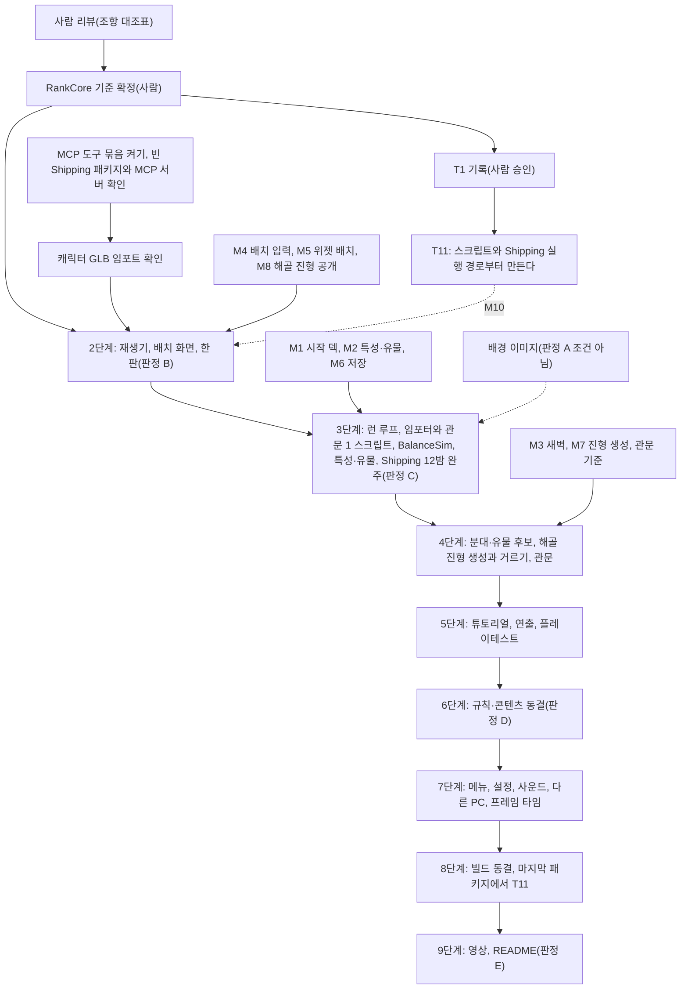

# 범위 축소 후보 정리 (2026-11-21)

작성: 2026-11-21. 상태: **검토 중 · AI 제안**.

범위(무엇을 버릴지)를 정하는 것은 사람이다(루트 `AGENTS.md` 6절). 이 문서는 무엇을 줄일지 정하지 않고, 정하는 데 쓸 자료만 모은다. AI의 의견은 [판단]으로 따로 표시했고, 묶음안은 7절에만 두었다.

## 목적

- 완료 기한 11/22(결정 11/20 단계 순서) 안에 완결된 런, Shipping 패키지, 플레이 영상까지 가려면 무엇을 줄일 수 있는지, 후보를 한곳에 모은다.
- 후보마다 줄어드는 일, 잃는 것, 함께 묶이는 후보, 막혀 있는 [미정] 결정과의 관계, 규칙·데이터·테스트 영향, 되돌리기 쉬운지, 크기를 같은 항목으로 적는다.
- 11/20에 본인은 "범위를 줄일지는 오늘(11/20) 끝난 작업량을 보고 정한다"고 했다(결정 11/20 변이 검사). 결정 11/20 범위 축소안은 아직 "검토 중 · AI 제안"이다. 그 결정에 쓸 자료다.

```
목표: 범위 축소 후보 전부(루트 AGENTS.md 8절 목록 6개, 결정 11/20 범위 축소안의 목록 밖 후보, 문서에서 찾은 추가 후보)를 같은 항목으로 정리하고, 단계별 막힘과 AI 의견(묶음안 3개)을 붙인 검토 자료가 생긴다
완료 기준: 후보마다 8개 항목(무엇을 줄이나, 줄어드는 작업, 잃는 것, 묶임·선후, [미정]과의 관계, 규칙·데이터·테스트 영향, 되돌리기, 크기 [판단])이 채워져 있다. 근거마다 파일과 절, 또는 결정 기록의 날짜와 첫 문장이 있다. 시간을 숫자로 추정한 곳이 없다. 하나를 고르지 않는다
검증 명령: 없음, 문서만
금지: 이 파일 말고 다른 파일을 만들거나 고치지 않는다(docs/decisions.md 포함). git은 읽기 명령만 쓴다. 빌드와 에디터를 실행하지 않는다. 범위를 정하지 않는다. 루트 8절 "줄이자고 제안하지 않는 것"과 변이 검사(결정 11/20 변이 검사)는 후보로 올리지 않는다. 개인 정보, 사용자 폴더가 들어간 경로, 메일 주소를 적지 않는다
산출물: docs/review/scope-reduction-options-2026-11-21.md
```

## 읽는 법

- 후보 번호: **L**은 루트 `AGENTS.md` 8절 목록(적힌 순서 그대로), **O**는 결정 11/20 범위 축소안 ②의 목록 밖 후보, **A**는 이 문서를 쓰며 다른 문서에서 찾은 추가 후보다.
- 크기 [판단]: 그 후보를 골랐을 때 **줄어드는 일의 양**을 후보끼리 견준 것이다(작음, 중간, 큼). 시간으로 적지 않는다. 고르면 새로 생기는 일(문서 고치기, 새 결정)은 "규칙·데이터·테스트 영향"과 "[미정]과의 관계"에 따로 적었다.
- 되돌리기: 동결 전에 다시 넣을 수 있는지를 본다. 규칙·콘텐츠 동결(루트 8절 6단계) 뒤에는 `docs/rules.md`, `Data/defs/`, `Data/accepted/`, 특성 어휘, `RankCore`의 규칙을 바꾸지 않고, 빌드 동결(8단계) 뒤에는 코드와 에셋을 바꾸지 않는다. 동결 뒤의 변경은 사람이 직접 요청한 것만 한다(루트 8절).
- "규칙 파일"은 `AGENTS.md` 10개다. 고치려면 수정안을 보이고 승인을 받는다(루트 2절).

결정 기록(`docs/decisions.md`) 약칭

| 약칭 | 행(날짜와 첫 문장) |
|---|---|
| 결정 11/16 아트 | 11/16 "아트: 유닛은 KayKit 3D, 배경은 AI로 생성한 이미지 3장(바닥 타일 2장, 원경 1장)" |
| 결정 11/17 C++ 경계 | 11/17 "로직은 C++에만 둔다." |
| 결정 11/20 지금 규칙 | 11/20 "지금 규칙(`docs/rules.md`, `Data/defs/`)으로 진행한다." 상태 `변경(11/20)` |
| 결정 11/20 시험 4가지 | 11/20 "3단계 밸런스 시뮬레이터(BalanceSim)에 넣을 시험 4가지." 상태 `검토 중 · AI 제안` |
| 결정 11/20 동결 없앰 | 11/20 "특정 시각에 잡힌 동결 지침을 모두 없앤다" 상태 `변경(11/20)` |
| 결정 11/20 단계 순서 | 11/20 "동결을 시각이 아니라 단계 순서로 정한다." |
| 결정 11/20 변이 검사 | 11/20 "변이 검사는 범위를 줄이는 대상에서 뺀다." |
| 결정 11/20 범위 축소안 | 11/20 "범위 축소안." 상태 `검토 중 · AI 제안` |
| 결정 11/20 교차 검증 승인 | 11/20 "위 행의 T5 교차 검증 절차안과 규칙 파일 수정안(...)을 제안대로 승인한다." |
| 결정 11/20 KayKit 원본 | 11/20 "KayKit 원본 파일(`SourceArt/KayKit/`의 GLB와 LICENSE)은 커밋하지 않고 `.gitignore`에 넣는다." |
| 결정 11/20 입력 오류 ② | 11/20 "입력 오류(`docs/rules.md` §3.6) 처리의 남은 [미정] 두 가지를 정한다." |
| 결정 11/20 해골 진형 생성 | 11/20 "해골 진형은 생성기로 미리 많이 만들어 BalanceSim에서 목표 승률 범위에 드는 것만 골라 `formations.csv`에 고정한다." |
| 결정 11/20 분대 모양 | 11/20 "분대 모양 검사(조항 대조표 "확인이 필요한 곳" 7번)" |

## 1. 지금 상태 (2026-11-21)

### 1.1 단계

- 1단계(코어와 테스트, 판정 A)에 남은 것: 사람의 리뷰와 `RankCore` 기준 확정, T1 기록, T11(Shipping 결정성) 구현, 캐릭터 GLB 임포트 확인, 배경 에셋 생성(작업 지시, `docs/devlog/2026-11-21.md` "하지 못한 것").
- 테스트: T5 19/19, T2 1,000/1,000, T3 1,000/1,000, T4 10,000/10,000, 보조 테스트 3개 통과, T1은 "기준 확정 전"으로 실패한다 [측정: `docs/devlog/2026-11-21.md` "검증한 방법"의 자동화 테스트, Development Editor, 커밋 `099f906`].
- 2~9단계는 모두 시작 전이다. 완료 기한은 11/22다(결정 11/20 단계 순서).

### 1.2 파일 목록으로 확인한 것 (11/21 작업 트리, `git ls-files`와 폴더 목록)

| 곳 | 있는 것 | 아직 없는 것 |
|---|---|---|
| `tools/` | `run_tests.bat`, `record_regression.bat`, `package.bat`, `hand_crosscheck.js` | `validate_content.js`(관문 1, T8), `run_sim.bat`(BalanceSim), `check_shipping_determinism.bat`(T11). 루트 4절: "스크립트가 아직 없으면 그 스크립트를 만드는 일이 먼저다" |
| `Source/RankGame` | `RankContent`(병과·규칙 CSV, 진형 행 읽기), `RankRegressionData`(회귀 입력 읽기, 기록 비교) | 런 진행(`URunSubsystem`), 전투 재생, 위젯과 뷰모델, 분대·유물·`formations.csv` 읽기(결정 11/20 분대 모양 "분대 CSV의 변환 함수는 아직 없어서"), Shipping 실행 파일이 실행 인자로 회귀 입력을 돌리는 코드(실행 인자를 읽는 코드가 `Source/`에 없다) |
| `Source/RankEditor` | RankRegression 커맨들릿 | 콘텐츠 임포터, BalanceSim |
| `Data/` | `defs/units.csv`, `defs/rules.csv` | `candidates/`, `accepted/`, `reports/` |
| `Content/` | `AGENTS.md`만 | 에셋 전부 |
| `RankAndFile.uproject` | 모듈 4개 | 플러그인 항목이 없다. Unreal MCP 도구 묶음을 아직 켜지 않은 것으로 보인다 [판단: 에디터 설정 화면은 보지 않았다] |
| `SourceArt/KayKit/` (git이 무시) | `Knight.glb`, `Skeleton_Minion.glb`(결정 11/20 KayKit 원본) | 나머지 7종, 무기 파일, Halloween Bits·Dungeon 팩 |

### 1.3 사람이 정하지 않은 것

| 번호 | [미정] | 출처 | 막는 단계 |
|---|---|---|---|
| M1 | 시작 덱, 밤별 기대 덱 크기, 보상에서 분대와 유물의 비율 | `docs/design.md` 15절 2번, `Data/AGENTS.md` "후보를 생성하기 전에", `Source/RankGame/AGENTS.md` UI 절 | 3단계 런 루프, 4단계 생성 시작 |
| M2 | 특성·유물의 처리 시점과 조각 수 | `docs/design.md` 6.8절, 15절 3번, `Data/AGENTS.md` 유물 형식, `Source/RankCore/AGENTS.md` "특성과 유물" | 3단계 특성·유물 구현과 T7, 4단계 분대·유물 형식 |
| M3 | 새벽 규칙을 둘지 | `docs/design.md` 15절 4번, `docs/balance-2026-11-15.md` 2.4절 | 4단계 유물 생성(15절 4번 "유물 생성 전") |
| M4 | 배치 입력 방식(UMG 격자, 3D 판 위 조작) | `docs/design.md` 8.3절, 15절 5번 | 2단계 |
| M5 | 위젯 배치를 디자이너로 할지 코드로 할지 | `docs/design.md` 8.4절, 15절 6번, `Source/AGENTS.md` UI 행 | 2단계, 7단계 메뉴 |
| M6 | 저장과 이어하기 | `docs/design.md` 8.5절, 15절 7번 | 3단계 또는 7단계 [판단: 문서에 어느 단계인지 없다] |
| M7 | 해골 진형 생성: 진형 수, 밤별 예산표(해골 수와 병과 비율), 생성기를 둘 곳, 거르는 기준 | 결정 11/20 해골 진형 생성 | 3단계(생성기), 4단계(거르기) |
| M8 | 배치할 때 해골 진형을 보여 줄지(전부, 숨김, 일부) | 결정 11/20 지금 규칙("같이 정할 것 [미정]") | 2단계 배치 화면, 3·4단계 탐색 봇 |
| M9 | 범위를 줄일지 자체 | 결정 11/20 변이 검사 | 전 단계 |
| M10 | 단계를 겹쳐 진행해도 되는지, 판정 A 밖의 1단계 일(T11, 임포트 확인, 배경)이 끝나야 2단계를 시작하는지 | 문서가 정하지 않았다 [판단]. 루트 8절은 "단계는 아래 순서로 진행"이고, `docs/design.md` 13.1 그림은 A 뒤에 재생·BalanceSim·특성을 나란히 둔다. 판정 A(`docs/design.md` 1절 표, 9.1절 아래 문단)에는 T11이 없고, 13.3절 11/16 4번은 T11을 1단계 일로 적는다 | 전 단계 |

## 2. 후보로 올리지 않은 것

| 대상 | 이유 |
|---|---|
| 결정성·미러·회귀 테스트, 완결된 런, 첫 밤 튜토리얼, Shipping 패키지, 플레이 영상, 개발 일지 | 루트 8절 "줄이자고 제안하지 않는 것" |
| 변이 검사 | 결정 11/20 변이 검사 |
| T11 Shipping 결정성 | 결정성 테스트의 하나로 본다 [판단]. 루트 4절 표가 기준 확정 뒤 `tools\check_shipping_determinism.bat` 20/20을 요구한다 |
| 다른 PC 실행, Shipping 3런 연속 크래시 0회 | Shipping 패키지가 실제로 돈다는 확인이다(`docs/design.md` 2절 완성 정의 1·3) [판단]. 본인이 다르게 보면 추가 후보로 옮길 수 있다 |
| T9 런 스모크, T10 재생 일치 | 완결된 런과 "재생은 결과를 계산하지 않는다"를 지키는 검사다(`Source/RankGame/AGENTS.md` 검증 절이 통과를 요구) [판단] |
| 첫 밤 튜토리얼을 배치 화면 안내 문구로 바꾸기 | `docs/design.md` 17절 UI 행의 대응이지만 첫 밤 튜토리얼을 줄이는 일이다. 같은 칸의 "설정을 한 화면으로"만 A4로 올렸다 |
| 사람 리뷰와 기준 확정, 교차 검증 절차 | `Source/RankCore/AGENTS.md` "기준으로 확정하는 절차"와 결정 11/20 교차 검증 승인이다. 줄일 일이 아니라 1단계의 끝이다 [판단] |
| BalanceSim 없이 손으로 진형을 만드는 것 같은 더 큰 축소 | 결정 11/20 해골 진형 생성(미리 생성해 거르기)을 바꾸는 일이고, 문서에 후보로 적힌 곳이 없다. 올리려면 그 결정부터 다시 봐야 한다 |

## 3. 후보 요약

| ID | 후보 | 줄어드는 단계 | 전투 규칙·코어 변경 | 되돌리기 | 크기 [판단] |
|---|---|---|---|---|---|
| L1 | 유물 12 → 6 | 4 | 없음 | 쉽다 | 작음 |
| L2 | 해골 진형 36 → 24 | 4 | 없음. 입력 오류 결정과 부딪친다 | 쉽다 | 작음 |
| L3 | 저장과 이어하기 안 만듦 | 3 또는 7 | 없음 | 쉽다 | 작음~중간 |
| L4 | 정예·우두머리 전용 연출 | 5 전, 7 | 없음 | 쉽다 | 작음 |
| L5 | 참조 시뮬레이터 웹 공개 | 9 | 없음 | 쉽다 | 작음 |
| L6 | 12밤 → 8밤 | 3~5, 7, 9 | 전투 규칙은 없음. 규칙 파일 여러 곳 | 중간 | 중간 |
| O1 | 특성 조각 16 → 0~4 | 3, 4 | 0이면 없음. 1개 이상이면 있음 | 0에서 되살리기 어렵다 | 0이면 큼 |
| O2 | 유물은 기존 매개변수를 바꾸는 효과만 | 3, 4 | 코어 코드는 없음 [판단]. 규칙 문장은 필요해 보인다 [판단] | 중간 | 중간 |
| O3 | 관문 2는 해골 진형 곡선만, 생성 1회 | 3, 4 | 없음 | 쉽다 | 중간 |
| O4a | 클릭 배치 | 2 | 없음 | 쉽다 | 작음~중간 |
| O4b | 코드로 하는 위젯 배치 | 2, 7 | 없음 | 어렵다 | 문서끼리 판단이 다르다 |
| O5 | 병과 모델 9종 → 2종, 색·무기로 구분 | 2 | 없음 | 쉽다 | 작음~중간 |
| O6 | 사운드 최소 | 7 | 없음 | 쉽다 | 작음~중간 |
| O7 | BalanceSim은 `formation`·`curve`만, 시험 4가지는 제출 뒤 | 3 | 없음 | 쉽다 | 중간(O3와 겹침) |
| A1 | 배경 AI 생성 대신 되돌릴 길, 가장자리 소품 빼기 | 1, 3 | 없음 | 쉽다 | 작음~중간 |
| A2 | 링크 발동 연출, 열별 결과 요약 줄이기 | 5 전 | 없음 | 쉽다 | 작음~중간 |
| A3 | 분대 카드 24 → 더 적게 | 4 | 없음 | 쉽다 | 작음 |
| A4 | 설정을 한 화면으로 | 7 | 없음 | 쉽다 | 작음 |
| A5 | 지인 플레이테스트 인원 줄이기 | 5 | 없음 | 쉽다 | 작음(사람의 일) |
| A6 | 프레임 타임을 장면 하나에서만 | 7 | 없음 | 쉽다 | 작음 |
| A7 | 애니메이션 블렌딩 조정(애니메이션 블루프린트) 안 함 | 2, 7 | 없음 | 쉽다 | 작음 |
| A8 | 무기 개별 부착 대신 캐릭터 파일의 무기 메시 | 2 | 없음 | 쉽다 | 작음 |
| A9 | 섬멸 다음 밤 다시 뽑기 빼기 | 3 | 없음(런 규칙은 바뀜) | 쉽다 | 작음 |
| A10 | 관문 2 해골 진형 허용 폭 ±5 → ±8%p | 4 | 없음 | 쉽다 | 작음~중간 |

## 4. 후보별 정리

### 4.1 루트 `AGENTS.md` 8절 목록 (L1~L6)

루트 8절: "범위를 줄이자고 제안할 때는 이 순서를 따른다: 유물 12 → 6, 해골 진형 36 → 24, 저장과 이어하기, 정예·우두머리 전용 연출, 참조 시뮬레이터 웹 공개, 마지막으로 12밤 → 8밤." `docs/design.md` 13.4절도 같은 목록이다.

#### L1 유물 12 → 6

| 항목 | 내용 |
|---|---|
| 무엇을 줄이나 | 출시 유물 수 12개를 6개로(`docs/design.md` 7.1절, 13.4절 1번) |
| 줄어드는 작업 | 4단계: 유물 후보의 관문 1·2와 사람 채택(관문 3)의 대상 수. 한 회차 후보 30개(`Data/AGENTS.md` "후보를 만들 때")를 함께 줄일지는 따로 정한다. 유물 효과를 구현하는 코드(3단계)와 그 T7 예제는 효과 **종류**에 달려 있어 줄지 않는다 [판단] |
| 잃는 것 | 보상 선택지의 다양성(보상은 분대나 유물 3장 가운데 1장, `docs/design.md` 8.1절). README 관문 통과율 행의 유물 숫자가 작아진다. 4단계 판정("12밤 중 10밤 이상이 목표 승률 ±5%p", `docs/design.md` 13.3절 11/19)은 그대로다 |
| 묶임·선후 | 목록의 첫 번째라, 목록에서 무엇을 고르든 이것이 먼저다(6절). O2와 함께 고르면 유물 쪽 엔지니어링도 준다. M1의 보상 비율과 맞물린다 |
| [미정]과의 관계 | M2(유물 처리 시점)는 그대로 필요하다. M1의 보상 비율을 정할 때 유물 수가 입력이 된다 |
| 규칙·데이터·테스트 | 전투 규칙 변경 없음. `Data/accepted/relics.csv`의 행 수만 달라진다. T1·T5 영향 없음 |
| 되돌리기 | 동결 전에는 쉽다(채택 행을 더한다). 규칙·콘텐츠 동결 뒤에는 `Data/accepted/`를 바꾸지 않는다 |
| 크기 [판단] | 작음. 줄어드는 것이 콘텐츠 양이고 엔지니어링이 아니다(결정 11/20 범위 축소안의 근거 칸도 같은 판단) |

#### L2 해골 진형 36 → 24

| 항목 | 내용 |
|---|---|
| 무엇을 줄이나 | 출시 해골 진형 36개(밤마다 3개, `docs/design.md` 7.1절)를 24개로(13.4절 2번). 12밤이면 밤마다 2개다 |
| 줄어드는 작업 | 4단계: 생성기로 만든 진형을 BalanceSim `formation` 모드로 거르고 사람이 채택하는 수. 11/20부터 진형은 AI 후보 90개가 아니라 생성기로 만들므로(결정 11/20 해골 진형 생성) 생성 자체의 일은 거의 같고, 거르기와 채택이 준다 [판단] |
| 잃는 것 | 같은 밤에 나올 수 있는 진형의 폭(런 난수가 밤마다 진형을 고른다, `docs/design.md` 8.1절 `FRunState`). "한 배치가 모든 밤을 이긴다(96.4%)"는 기획 단계 점검(`docs/balance-2026-11-15.md` 2.4절 [산정])이 있는 상태라, 진형이 적으면 같은 답이 런마다 통하기 쉽다 [판단] |
| 묶임·선후 | 루트 8절 순서상 L1 다음. L6과 겹친다: 8밤 × 밤마다 3개도 24개다. L6까지 고르면 "24개"가 8밤 × 3개인지 8밤 × 2개(16개)인지 정해야 한다 |
| [미정]과의 관계 | M7의 "진형 수"가 정해진다. 밤별 예산표, 생성기를 둘 곳, 거르는 기준은 그대로 필요하다 |
| 규칙·데이터·테스트 | 전투 규칙 변경 없음. **부딪치는 결정이 있다**: 결정 11/20 입력 오류 ②는 해골 진형판이 비면 "그 밤의 다른 진형으로 바꾼다. 2번 바꿔도 안 되면 오류를 UI로 알리고 게임을 끝낸다"이고, 근거가 "밤마다 진형이 3개라 2번까지 바꿀 수 있다"다(`docs/design.md` 8.1절에도 같은 문장). 밤마다 2개면 1번만 바꿀 수 있어 이 결정을 다시 정해야 한다. `Data/AGENTS.md` 해골 진형 형식("밤마다 3개를 둔다")과 `docs/design.md` 7.1절도 고친다(규칙 파일은 승인). 회귀 입력은 고정 파일이라 영향 없음 |
| 되돌리기 | 동결 전에는 쉽다(생성기와 거르기를 다시 돌린다). 동결 뒤에는 바꾸지 않는다 |
| 크기 [판단] | 작음 |

#### L3 저장과 이어하기

| 항목 | 내용 |
|---|---|
| 무엇을 줄이나 | 런 저장과 이어하기를 만들지 않는다(`docs/design.md` 8.5절, 13.4절 3번, 15절 7번) |
| 줄어드는 작업 | 저장 코드(8.5절 제안: `FRunState`의 시드와 선택 이력만 저장), 메인 메뉴의 이어하기 항목, 불러온 런이 같은 상태인지 확인하는 일. 어느 단계에서 만들지는 문서에 없다 [판단: 3단계 런 루프나 7단계 메뉴] |
| 잃는 것 | 런 도중에 끄면 처음부터 다시 한다. 완성 정의(`docs/design.md` 2절)와 README 검증 기록 표에는 해당 항목이 없다 |
| 묶임·선후 | 루트 8절 순서상 L2 다음. 시드와 선택 이력으로 런을 다시 만드는 성질(T9, `docs/design.md` 8.1절)은 저장이 없어도 남는다 |
| [미정]과의 관계 | M6이 "만들지 않음"으로 정리된다 |
| 규칙·데이터·테스트 | 없음 |
| 되돌리기 | 쉽다. `FRunState`에 시드와 선택 이력이 그대로 있으면 나중에 더할 수 있다 [판단]. 빌드 동결 뒤에는 더하지 않는다 |
| 크기 [판단] | 작음~중간 |

#### L4 정예·우두머리 전용 연출

| 항목 | 내용 |
|---|---|
| 무엇을 줄이나 | 4·8번째 밤(정예)과 12번째 밤(우두머리)의 전용 연출(`docs/design.md` 13.4절 4번). 정예·우두머리 밤과 진형 종류(`kind`)는 그대로 둔다 |
| 줄어드는 작업 | 연출 작업. "전용 연출"의 목록은 `docs/design.md`에 없고, `docs/background.md` 2.5절 "열두 밤의 변화"(정예 밤의 붉은 기운, 우두머리 밤의 붉은 달, 머티리얼 파라미터 컬렉션)가 "밀리면 버린다 ... 4번에 함께 넣는다"고 적혀 있다 [미확인: 그 밖에 무엇이 들어가는지. 확인 방법: 본인에게 묻는다] |
| 잃는 것 | 정예·우두머리 밤이 화면에서 덜 구별된다. 영상의 볼거리 [판단] |
| 묶임·선후 | 루트 8절 순서상 L3 다음. A1(배경)과 같은 전장 작업이다 |
| [미정]과의 관계 | `docs/background.md` 10절 2번(열두 밤의 색 변화를 넣을지)이 정리된다 |
| 규칙·데이터·테스트 | 없음 |
| 되돌리기 | 쉽다(빌드 동결 전) |
| 크기 [판단] | 작음 |

#### L5 참조 시뮬레이터 웹 공개

| 항목 | 내용 |
|---|---|
| 무엇을 줄이나 | 기획 단계 JS 웹 시뮬레이터의 링크 공개(`docs/design.md` 13.3절 11/22 4번 "(선택)", 13.4절 5번) |
| 줄어드는 작업 | 9단계: 공개 전에 JS와 C++의 결과를 비교하는 일(`docs/design.md` 9.0절 "공개하려면 그 전에 두 결과를 비교한다"). JS 파일은 이 저장소에 없다(`docs/design.md` 머리 표) |
| 잃는 것 | 외부에 보여 줄 것 하나. 판정 기준, README 검증 기록과는 관계없다 |
| 묶임·선후 | 루트 8절 순서상 L4 다음 |
| [미정]과의 관계 | 없음 |
| 규칙·데이터·테스트 | 없음. JS는 기준이 아니다(루트 1절) |
| 되돌리기 | 쉽다. 제출 뒤에도 할 수 있다 [판단] |
| 크기 [판단] | 작음. 이미 선택 작업이다 |

#### L6 12밤 → 8밤

| 항목 | 내용 |
|---|---|
| 무엇을 줄이나 | 런을 12밤에서 8밤으로(루트 8절 "마지막으로", `docs/design.md` 13.4절 6번 "마지막 수단", 13.3절 11/18 7번 "판정 C 실패하면 런을 8밤으로 줄인다") |
| 줄어드는 작업 | 4단계 진형 생성·거르기의 밤 수, 3단계 판정 C(Shipping으로 12밤 완주 → 8밤), 5단계 한 런의 플레이 길이, 7단계 3런 연속 크래시 확인의 길이, 9단계 영상 촬영 [판단]. 런 루프 코드의 양은 거의 같다 [판단] |
| 잃는 것 | 12밤 구조와 난이도 곡선의 길이. 보상을 받는 횟수가 줄어 덱이 덜 자란다. 3패 허용이 8밤 중 3패가 되어 비율이 바뀐다 [판단]. 4단계 판정("12밤 중 10밤 이상")과 README 난이도 곡선 행("12밤 중 ±5%p 안인 밤 수")을 다시 적는다 |
| 묶임·선후 | 목록의 마지막이라 루트 8절 순서상 L1~L5를 먼저 고른 뒤다. L2와 겹친다(L2 참고) |
| [미정]과의 관계 | 새 [미정]이 생긴다: 8밤용 목표 승률 곡선(결정 11/20 범위 축소안 "8밤이면 목표 승률 곡선을 새로 정해야 한다"), 정예·우두머리 밤의 위치(지금 4·8·12), 3패를 유지할지. M1(밤별 기대 덱 크기)과 M7(밤별 예산표)은 8밤 기준으로 정한다 |
| 규칙·데이터·테스트 | `docs/rules.md`는 밤 수를 다루지 않는다(§2.1의 "밤(한 판)마다" 말고 없음) [판단]. 그래서 손계산 재계산, 교차 검증, 회귀 재기록은 생기지 않는다 [판단]. 고칠 문서: 루트 `AGENTS.md` 1절("12밤"), `Source/RankGame/AGENTS.md` 런 진행, `Data/AGENTS.md`(목표 곡선, `night` 1~12, 정예·우두머리), `docs/design.md` 1·8.1·10절. 규칙 파일이라 수정안과 승인이 필요하다. 관문 1 스크립트(아직 없음)의 `night` 범위도 맞춘다. 회귀 입력의 밤 3·7·12 진형(`docs/design.md` 9.2절)은 고정 입력이라 그대로 쓸 수 있다 [판단] |
| 되돌리기 | 중간. 문서와 곡선을 다시 바꾸고 밤 9~12의 진형을 새로 걸러야 한다. 동결 뒤에는 바꾸지 않는다 |
| 크기 [판단] | 중간 |

### 4.2 결정 11/20 범위 축소안의 목록 밖 후보 (O1~O7)

행의 ②에 적힌 7개다: "특성 조각 16 → 0~4개, 유물은 기존 매개변수를 바꾸는 효과로만, 관문 2는 해골 진형 승률 곡선만 보고 생성은 1회, 클릭 배치와 코드로 하는 위젯 배치, 병과 9종 모델 → 2종에 색·무기로 구분, 사운드 최소, BalanceSim은 `formation`·`curve` 모드만(같은 날 "시험 4가지"는 제출 뒤로)". 네 번째는 [미정] 두 개(M4, M5)에 따로 걸려 O4a와 O4b로 나눴다.

#### O1 특성 조각 16 → 0~4개

| 항목 | 내용 |
|---|---|
| 무엇을 줄이나 | 분대 특성의 어휘 조각 16개(언제 5종, 무엇 6종, 누구 5종, `docs/design.md` 6.8절)를 0~4개로. "0~4개"가 조각 수인지 특성 조합 수인지 행에 없다 [미확인: 확인 방법은 본인에게 묻는다] |
| 줄어드는 작업 | 0이면 3단계의 큰 덩어리가 빠진다: 특성 처리 시점의 규칙 조항, `RankCore`의 특성 구현과 이벤트 종류 5 "효과"(6.8절), T7(조각마다 예제 2개 이상, AI 계산과 교차 검증. 결정 11/20 교차 검증 승인 ①이 T7을 교차 검증 범위에 넣었다), 특성이 들어간 덱으로 T2·T3 다시 돌리기(`Source/RankCore/AGENTS.md` "특성과 유물"), 카드 설명문 템플릿(`docs/design.md` 7.2절), 관문 2 "중복"(효과 벡터의 유사도)의 대부분. 1~4개면 이 일이 모두 남고 조각 수만 준다 |
| 잃는 것 | 분대 카드의 차이가 병과, 모양, tier만 남는다. "코드는 정해진 어휘 조각만 구현한다"는 설계 원칙 3(`docs/design.md` 3절)의 특성 쪽이 비게 된다. 카드를 고르는 재미 [판단] |
| 묶임·선후 | O2와 함께 고르면 전투 중 효과 체계가 통째로 빠진다. A3(분대 수)와 맞물린다: 특성이 없으면 서로 다른 카드를 많이 만들기 어렵다 [판단]. 분대 CSV는 특성 0개를 이미 받는다(`Data/AGENTS.md` 분대 `trait*` "없으면 다섯 칸을 모두 비운다") |
| [미정]과의 관계 | 0이면 M2의 특성 부분(처리 시점, 조각 수)이 필요 없어진다. 1~4개면 처리 시점은 그대로 필요하고, 어느 조각을 남길지가 새 [미정]이 된다(특성 어휘는 사람이 정한다, 루트 6절) |
| 규칙·데이터·테스트 | 0이면 기준 확정 뒤 `RankCore`의 동작이 바뀌지 않는다. 1개 이상이면 규칙 변경이다: `docs/rules.md`에 조항 → AI가 T7 기대값 계산 → 교차 검증(본인이 Antigravity로 검증자 실행) → `RankCore` 구현 → T2·T3 → 결과가 바뀐 회귀 대전을 보이고 승인 → `tools\record_regression.bat` → `tools\check_shipping_determinism.bat` 20/20(루트 4절, 결정 11/20 지금 규칙의 ②). 기준 확정 전에 넣으면 기준 확정이 그만큼 늦어지고, 뒤에 넣으면 기준 확정 뒤의 절차가 한 번 더 든다 [판단]. `docs/rules.md`를 고치면 교차 검증의 `inputsId`가 바뀐다(결정 11/20 교차 검증 승인) |
| 되돌리기 | 0에서 되살리기는 어렵다: 위 규칙 변경 절차 전체가 든다. 규칙·콘텐츠 동결 뒤에는 특성 어휘를 바꾸지 않는다(루트 8절 6단계) |
| 크기 [판단] | 0이면 큼. 1~4개면 작음~중간 |

#### O2 유물은 기존 매개변수를 바꾸는 효과로만

| 항목 | 내용 |
|---|---|
| 무엇을 줄이나 | 유물 효과 "규칙 매개변수를 바꾸거나(예: 최대 틱 −50), 조건에 맞는 유닛에 전투 시작 효과를 준다"(`docs/design.md` 6.8절) 가운데 앞쪽만 남긴다. 형식 예시는 `rl_dawn_bell,새벽의 종,Rule,MaxTicks,-50`(`docs/design.md` 7.2절, `Data/AGENTS.md` 유물 형식) |
| 줄어드는 작업 | 유물의 전투 시작 효과 경로와 그 T7 예제. O1을 0으로 함께 고르면 전투 중 효과 체계가 빠진다 |
| 잃는 것 | 유물 종류의 폭. 규칙 매개변수는 `maxTicks`, `gateHp`, `gateDamage`, `linkStackMax`, `rangeMax`, `intervalMin` 6개뿐이다(`Data/defs/rules.csv`) |
| 묶임·선후 | O1, L1과 함께 본다 |
| [미정]과의 관계 | M2의 유물 처리 시점이 "전투 전에 입력값을 바꾼다"로 쉬워진다 [판단]. M3과 맞물린다: 문서의 예시 유물이 최대 틱 −50인데, 600틱에 닿는 전투가 거의 없다는 점검이 있다(`docs/balance-2026-11-15.md` 2.4절 [산정]). "기존 매개변수"가 규칙 매개변수만인지 병과 수치(`units.csv`)도 포함하는지 행에 없다 [미확인: 본인에게 묻는다] |
| 규칙·데이터·테스트 | 코어는 매개변수를 입력으로 받으므로 코드를 바꾸지 않아도 된다 [판단]. 걸리는 곳 두 가지 [판단]: ① 성문과 결계는 값 하나(`gateHp`)를 함께 쓴다(`docs/rules.md` §7, `RankTypes.h`의 `FRuleParams`). 플레이어 쪽만 바꾸는 유물이면 진영별 값이 필요해 규칙 변경이 된다 ② `docs/rules.md`는 600틱 같은 값을 문장에 숫자로 적고 §7은 값의 기준을 `Data/defs/`로 정한다. 유물로 바뀐 값을 쓴다는 것을 규칙 문서에 적어야 해 보이고, 문서를 고치면 `inputsId`가 바뀐다. 이미 받은 교차 확인 상태를 다시 받아야 하는지는 문서에 없다 [미확인: `docs/crosscheck/README.md`에 해당 경우가 없다]. 병과 수치를 바꾸는 유물이면 아군 병과(K, B, R, M, H)는 플레이어 쪽에만 있어 한쪽만 바뀐다 [판단] |
| 되돌리기 | 중간. 전투 시작 효과를 나중에 더하면 규칙 변경 절차가 든다 |
| 크기 [판단] | 중간 |

#### O3 관문 2는 해골 진형 승률 곡선만 보고 생성은 1회

| 항목 | 내용 |
|---|---|
| 무엇을 줄이나 | 관문 2(`docs/design.md` 10절, `Data/AGENTS.md` "세 관문")의 기여도, 독주, 중복, 병과 검사 [제안]을 빼고 해골 진형 검사만 둔다. 후보 생성은 회차 하나로 끝낸다(탈락 사유를 붙인 2차 생성, `docs/design.md` 13.3절 11/19 3번을 하지 않는다) |
| 줄어드는 작업 | 3단계 BalanceSim `card` 모드(넣은 덱과 뺀 덱, 두 장 조합, 유사도)와 `class` 모드. 4단계 2차 생성, 탈락 사유 JSON 모으기, 회차별 기록 |
| 잃는 것 | 분대와 유물은 관문 1과 사람(관문 3)만 거친다. 독주 카드나 지배 전략을 시뮬레이션으로 잡지 못한다. "회차별 통과율이 AI 콘텐츠 파이프라인의 기록이다"(`docs/design.md` 10절)와 README 관문 통과율 행이 얇아진다 [판단] |
| 묶임·선후 | O7과 한 묶음이다. `card` 모드가 관문 2의 기여도·독주·중복에 쓰이므로, O3 없이 O7만 고르면 관문 2를 돌릴 수 없다 |
| [미정]과의 관계 | 관문 2의 카드 기준(관문 통과 기준은 사람이 정한다, 루트 6절)을 정할 필요가 없어진다. M1은 탐색 봇에 그대로 필요하다. M7의 거르는 기준으로 "목표 곡선 ±5%p"가 남는다 |
| 규칙·데이터·테스트 | 전투 규칙 변경 없음. `Data/AGENTS.md`의 관문 표와 "통과율이 낮다고 기준을 넓히거나 검사를 빼지 않는다"와 어긋나므로, 본인이 범위를 정했다는 것을 규칙 파일에 반영해야 한다(승인). 진형은 11/20부터 생성기로 만들어(결정 11/20 해골 진형 생성), 진형에서 "생성 1회"는 "생성기 1회와 거르기"가 된다 [판단] |
| 되돌리기 | 쉽다. `card` 모드는 나중에 더할 수 있다. 채택한 분대·유물은 동결 뒤에 바꾸지 않는다 |
| 크기 [판단] | 중간 |

#### O4a 클릭 배치

| 항목 | 내용 |
|---|---|
| 무엇을 줄이나 | 배치 화면의 드래그(`docs/design.md` 8.3절 "분대 드래그, 회전(R)")를 클릭 배치로. 8.3절 "판정 B에서 드래그가 안 되면 클릭 배치로 줄인다"를 미리 고르는 것이다 |
| 줄어드는 작업 | 2단계 배치 화면의 끌어 놓기 처리 [판단] |
| 잃는 것 | 조작감. `docs/design.md` 17절 "배치 조작이 불편하다(한 밤 배치에 1분 이상)" 위험이 커질 수 있다 [판단] |
| 묶임·선후 | O4b와 따로 고를 수 있다. 우클릭·휠 회전과 직전 배치 불러오기(8.3절 "배치에 1분 넘게 걸리면")는 함께 미룰 수 있다 |
| [미정]과의 관계 | M4의 한 부분(드래그인지 클릭인지)이 정해진다. 격자 위젯인지 3D 판인지는 남는다 [판단] |
| 규칙·데이터·테스트 | 없음. 놓을 수 있는지는 `FFormationMask::CanPlace`, 링크 미리보기는 `Rank::ComputeLinks`를 그대로 쓴다(`Source/RankGame/AGENTS.md`) |
| 되돌리기 | 쉽다. 클릭 배치 위에 드래그를 더할 수 있다 [판단] |
| 크기 [판단] | 작음~중간 |

#### O4b 코드로 하는 위젯 배치

| 항목 | 내용 |
|---|---|
| 무엇을 줄이나 | 위젯 배치를 위젯 블루프린트 디자이너가 아니라 C++ 코드로 한다(M5의 한쪽) |
| 줄어드는 작업 | Unreal MCP로 위젯 블루프린트를 만들고 설정하는 일, 개수와 캡처로 확인하는 일, 사람의 수용 판정("MCP로 만든 위젯·애니메이션 블루프린트를 받아들일지", 루트 6절) [판단] |
| 잃는 것 | 에디터에서 하는 마지막 미세 조정(루트 6절). 코드로 짠 위젯 트리는 디자이너에서 고칠 수 없다(`docs/design.md` 8.4절) |
| 묶임·선후 | A4와 함께 보면 7단계 UI도 준다. MCP 도구 묶음은 캐릭터 임포트에도 쓰므로(`Content/AGENTS.md` "AI는 Unreal MCP를 통해서만 에셋을 다룬다") 이것만으로 MCP를 켜는 일은 없어지지 않는다 |
| [미정]과의 관계 | M5가 정해진다 |
| 규칙·데이터·테스트 | 전투 규칙 변경 없음. `Source/AGENTS.md`와 `Content/AGENTS.md`는 위젯 블루프린트와 `meta=(BindWidget)` 방식을 기본으로 적고 있어, 문장을 맞출지 본인이 본다 [판단] |
| 되돌리기 | 어렵다. 코드로 짠 위젯 트리를 디자이너로 옮기려면 다시 만든다(`docs/design.md` 8.4절) |
| 크기 [판단] | 문서끼리 판단이 다르다. `docs/design.md` 8.4절의 [판단]은 "디자이너 배치가 조정과 이어지고 시간이 덜 든다"이고, 결정 11/20 범위 축소안은 코드 배치를 줄이는 쪽에 넣었다. 둘 다 AI 판단이라 이 문서는 크기를 정하지 않는다 |

#### O5 병과 모델 9종 → 2종, 색과 무기로 구분

| 항목 | 내용 |
|---|---|
| 무엇을 줄이나 | KayKit 9종(`docs/design.md` 8.6절, `Content/AGENTS.md` "캐릭터 임포트") 대신 2종을 쓰고 병과는 색과 무기로 구분한다. 어떤 2종인지는 행에 없다 [미확인]. 받아 둔 `Knight`와 `Skeleton_Minion`(결정 11/20 KayKit 원본)으로 보인다 [판단] |
| 줄어드는 작업 | 나머지 7종의 원본 받기와 기록(결정 11/20 KayKit 원본처럼 출처 커밋과 해시를 적는다), 임포트, Skeleton 공유 확인(`docs/design.md` 17절 "9종이 Skeleton을 공유하지 못한다" 위험), 병과별 메시 연결 |
| 잃는 것 | 병과를 한눈에 읽기 어려워진다(`Content/AGENTS.md` 배경 기준 6번은 9종이 바닥에 묻히지 않는지를 본다). 영상의 볼거리 [판단] |
| 묶임·선후 | **색 규칙과 부딪칠 수 있다**: "색마다 뜻이 하나다: 청록은 아군, 붉은색은 적, 금색은 링크, 보라는 결계, 주황은 성문 등불, 노랑은 해골 눈"(`Content/AGENTS.md` "렌더링과 색"). 병과 색을 이 색과 겹치지 않게 골라야 한다. 무기 부착(`docs/design.md` 8.6절)은 남고 오히려 중요해진다. A8과 함께 고르기 어렵다 |
| [미정]과의 관계 | 쓸 2종, 병과별 색과 무기가 새 [미정]이다. 이벤트별 애니메이션 표(`docs/design.md` 8.2절)는 병과마다 그대로 쓸 수 있다 [판단] |
| 규칙·데이터·테스트 | 전투 규칙 변경 없음. 데이터 에셋(`DA_`)의 메시 연결만 달라진다. `Content/AGENTS.md`의 "쓰는 모델은 9종이다" 문장을 고친다(승인) |
| 되돌리기 | 쉽다. 병과별 메시는 데이터 에셋에서 읽으므로(`Source/RankGame/AGENTS.md` 전투 재생) 나중에 메시만 바꾼다 [판단] |
| 크기 [판단] | 작음~중간. 첫 2종의 임포트와 Skeleton 공유가 되면 나머지 7종은 같은 절차의 반복이다 |

#### O6 사운드 최소

| 항목 | 내용 |
|---|---|
| 무엇을 줄이나 | 이벤트 종류마다 하나씩(공격, 피격, 쓰러짐, 부활, 성문 타격, 승리, 패배, `docs/design.md` 8.5절)을 몇 개로. "최소"의 범위는 행에 없다 [미확인] |
| 줄어드는 작업 | 7단계 사운드 고르기와 연결, 라이선스 확인과 크레딧의 대상 수 |
| 잃는 것 | 타격감, 영상의 소리 [판단]. 음량 설정(완성 정의 4)은 그대로 남는다 |
| 묶임·선후 | 사운드 팩은 내용과 라이선스를 아직 확인하지 않았고, 사람이 확인하기 전에는 넣지 않는다(`Content/AGENTS.md` "라이선스와 크레딧"). 이 확인은 사운드를 줄여도 남는다 |
| [미정]과의 관계 | 기존 [미정]과는 관계없다. 남길 사운드 목록이 새로 정할 것이다 |
| 규칙·데이터·테스트 | 없음 |
| 되돌리기 | 쉽다(빌드 동결 전) |
| 크기 [판단] | 작음~중간 |

#### O7 BalanceSim은 `formation`·`curve` 모드만, 시험 4가지는 제출 뒤

| 항목 | 내용 |
|---|---|
| 무엇을 줄이나 | BalanceSim 네 모드(`card`, `formation`, `class`, `curve`, `docs/design.md` 11절, `Source/RankEditor/AGENTS.md`) 가운데 `formation`과 `curve`만 만든다. 결정 11/20 시험 4가지(검토 중 · AI 제안)는 제출 뒤로 미룬다 |
| 줄어드는 작업 | 3단계 `card`·`class` 모드, 시험 4가지(① 기획 단계 [산정]을 C++로 다시 재기 ② 탐색 봇 강도 바꾸기 ③ 배치 전략 비교 ④ 작은 덱의 모든 배치 세기) |
| 잃는 것 | `docs/balance-2026-11-15.md`의 [산정] 값이 [측정]으로 바뀌지 않는다. 결정 11/20 지금 규칙의 걱정(링크와 해골 진형이 승패에 미치는 영향, 지배 전략)을 동결 전에 재지 못해, 링크 규칙을 고칠지 판단할 자료가 플레이테스트만 남는다 [판단]. 관문 2 병과 검사 [제안]이 빠진다. README BalanceSim 처리량 행은 `formation` 모드로도 잴 수 있다 [판단] |
| 묶임·선후 | O3과 한 묶음이다(O3 참고). 시험 ①의 "링크 끔"을 하려면 링크를 끄는 입력이 필요한데, `docs/design.md` 6.1절 스케치의 `bLinks`가 실제 코드(`RankTypes.h`의 `FRuleParams`)에 없다. 미루면 이 문제도 함께 뒤로 간다 [판단] |
| [미정]과의 관계 | 기존 [미정]과는 관계없다 |
| 규칙·데이터·테스트 | 없음 |
| 되돌리기 | 쉽다. 같은 명령과 같은 시드는 같은 CSV를 내므로(`Source/RankEditor/AGENTS.md`) 제출 뒤에 모드를 더해도 비교할 수 있다 |
| 크기 [판단] | 중간. O3과 함께 고르면 겹치는 일(`card` 모드)을 한 번만 센다 |

### 4.3 추가 후보 (A1~A10)

문서를 읽다가 본 것이다. 결정 11/20 범위 축소안과 루트 8절에는 없다. 루트 8절 순서 안의 어디에 끼는지는 문서가 정하지 않았다(6절).

#### A1 배경: AI 생성 대신 되돌릴 길, 가장자리 소품 빼기

| 항목 | 내용 |
|---|---|
| 무엇을 줄이나 | 1단계에 남은 배경 이미지 3장 AI 생성(결정 11/16 아트, `docs/background.md`, `Content/AGENTS.md` "배경 이미지")을 하지 않고, `docs/background.md` 9절 "되돌릴 길"(KayKit 바닥 조각, 단색 그라데이션 하늘과 나무 실루엣)이나 회색 바닥(`docs/design.md` 13.3절 11/17 4번)으로 둔다. 가장자리 소품(`docs/design.md` 8.6절 "선택")도 뺀다 |
| 줄어드는 작업 | 생성, 고르는 기준 8개 확인(명도와 채도를 코드로 잰다), 개발 일지 기록(도구, 프롬프트, 후보 수), 생성 도구의 이용 약관 확인(`Content/AGENTS.md` [미확인]), README의 AI 생성 범위 |
| 잃는 것 | 영상의 화면 품질 [판단]. 되돌릴 길의 KayKit Halloween Bits·Dungeon 팩은 아직 받지 않았다(1.2절) |
| 묶임·선후 | 배경 생성은 판정 A의 조건이 아니다(`docs/design.md` 13.3절 11/16 5번 "판정 A가 먼저다"). 그래서 빼지 않고 뒤로 미루는 것만으로도 1단계가 짧아진다 [판단]. L4와 같은 전장 작업이다 |
| [미정]과의 관계 | `docs/background.md` 10절 3번(생성 도구)이 필요 없어진다 |
| 규칙·데이터·테스트 | 전투 규칙 변경 없음. 결정 11/16 아트(배경은 AI 생성 이미지 3장)를 바꾸는 일이라 본인이 정한다. `Content/AGENTS.md` "배경 이미지 3장은 AI로 만든다" 문장을 고친다(승인) |
| 되돌리기 | 쉽다(빌드 동결 전) |
| 크기 [판단] | 작음~중간 |

#### A2 링크 발동 연출, 열별 결과 요약 줄이기

| 항목 | 내용 |
|---|---|
| 무엇을 줄이나 | `docs/design.md` 13.3절 11/20 1번의 "링크 발동 연출, 열별 결과 요약"과 결과 화면의 열별 요약(8.4절). 같은 줄의 첫 밤 튜토리얼은 빼지 않는다 |
| 줄어드는 작업 | 플레이테스트 전의 연출 작업, 결과 화면 일부 |
| 잃는 것 | `docs/design.md` 17절 "자동 전투가 지루하다"의 대응이 이것이다. 링크가 퍼즐의 중심이라 발동이 보이지 않으면 플레이테스트의 "이해하지 못한 규칙 수"가 늘 수 있다 [판단]. 배치 화면의 링크 미리보기(8.3절)는 남는다 |
| 묶임·선후 | 튜토리얼과 같은 줄에 있지만 따로 고를 수 있다 |
| [미정]과의 관계 | 없음 |
| 규칙·데이터·테스트 | 없음. 열별 요약은 `FBattleResult`의 값을 옮길 뿐이다(`docs/design.md` 4.3절) |
| 되돌리기 | 쉽다(빌드 동결 전) |
| 크기 [판단] | 작음~중간 |

#### A3 분대 카드 24 → 더 적게

| 항목 | 내용 |
|---|---|
| 무엇을 줄이나 | 출시 분대 카드 24장(`docs/design.md` 7.1절)을 더 적게. 수는 본인이 정한다 |
| 줄어드는 작업 | 4단계 분대 후보의 관문과 채택. 11/20부터 AI가 만드는 콘텐츠는 분대와 유물만 남는다(결정 11/20 해골 진형 생성의 근거 칸) |
| 잃는 것 | 보상 다양성, 런마다 다른 덱. README 관문 통과율 숫자 |
| 묶임·선후 | O1과 맞물린다(특성이 없으면 서로 다른 카드를 많이 만들기 어렵다 [판단]). L1과 같은 종류의 축소다 |
| [미정]과의 관계 | 카드 수가 새 [미정]이다. M1과 함께 정해야 한다: 시작 덱이 카드 풀에서 나오는지 문서에 없다 [미확인] |
| 규칙·데이터·테스트 | 전투 규칙 변경 없음. `Data/AGENTS.md`의 분량(후보 60, 출시 24) 문장을 고친다(승인) |
| 되돌리기 | 쉽다(동결 전) |
| 크기 [판단] | 작음 |

#### A4 설정을 한 화면으로

| 항목 | 내용 |
|---|---|
| 무엇을 줄이나 | 설정(해상도, 창 모드, 음량)을 한 화면에 모은다. `docs/design.md` 17절 "UI 동작을 C++로 붙이는 데 시간이 많이 든다"의 대응("설정을 한 화면으로")이다. 메인 메뉴, 일시정지, 재시작, 크레딧은 완성 정의 4·7(`docs/design.md` 2절)에 있어 남긴다 |
| 줄어드는 작업 | 7단계 화면 수와 위젯·뷰모델 연결 |
| 잃는 것 | 거의 없다 [판단]. 완성 정의 4의 항목은 그대로다 |
| 묶임·선후 | O4b. 17절 같은 칸의 "튜토리얼을 배치 화면 안내 문구로"는 올리지 않았다(2절) |
| [미정]과의 관계 | 없음 |
| 규칙·데이터·테스트 | 없음 |
| 되돌리기 | 쉽다(빌드 동결 전) |
| 크기 [판단] | 작음 |

#### A5 지인 플레이테스트 인원 줄이기

| 항목 | 내용 |
|---|---|
| 무엇을 줄이나 | 완성 정의 2 "처음 하는 사람이 설명 없이 첫 밤을 이긴다(지인 2명)"(`docs/design.md` 2절)와 13.3절 11/20 2번 "지인 2명"의 인원. 플레이테스트 단계 자체는 뺄 수 없다: 규칙·콘텐츠 동결이 "플레이테스트가 끝나면"이다(루트 8절) |
| 줄어드는 작업 | AI의 일은 거의 줄지 않는다. 사람의 시간과 사람을 구하는 일이 준다 |
| 잃는 것 | 첫 밤 튜토리얼이 통하는지 확인하는 근거가 약해진다. README 플레이테스트 행의 숫자 |
| 묶임·선후 | 첫 밤 튜토리얼(줄이지 않는 것)을 확인하는 일이다 [판단]. 그래서 사람이 따로 판단할 일로 적는다 |
| [미정]과의 관계 | 없음 |
| 규칙·데이터·테스트 | 없음. `docs/design.md` 2절 완성 정의 문장을 고친다 |
| 되돌리기 | 제출 뒤에도 더 받을 수 있다. 다만 지인이 이해하지 못한 규칙을 고치는 일(13.3절 11/20 3번)은 규칙·콘텐츠 동결 전에만 할 수 있다 |
| 크기 [판단] | 작음(사람의 일) |

#### A6 프레임 타임을 장면 하나에서만

| 항목 | 내용 |
|---|---|
| 무엇을 줄이나 | 프레임 타임 측정(완성 정의 6, 루트 7절 "프레임 타임은 Test 구성의 패키지에서 재고 PC 사양, 장면과 함께 적는다")을 장면 하나로 |
| 줄어드는 작업 | 7단계 측정 횟수. Test 구성 패키지를 만드는 일은 남는다: `tools\package.bat`은 Shipping 패키지를 만든다(`README.md` "Shipping 패키지") [판단] |
| 잃는 것 | README 프레임 타임 행이 장면 하나가 된다 |
| 묶임·선후 | 없음 |
| [미정]과의 관계 | 없음 |
| 규칙·데이터·테스트 | 없음 |
| 되돌리기 | 쉽다 |
| 크기 [판단] | 작음 |

#### A7 애니메이션 블렌딩 조정을 하지 않음

| 항목 | 내용 |
|---|---|
| 무엇을 줄이나 | 끊김이 보여도 애니메이션 블루프린트로 블렌딩을 맞추지 않고 `PlayAnimation` 직접 재생으로 둔다(`docs/design.md` 8.2절, 17절 "시간이 없으면 연출 문제로 두고 진행한다") |
| 줄어드는 작업 | C++ `UAnimInstance` 하위 클래스, MCP로 애니메이션 블루프린트 만들기, 사람의 수용 판정(루트 6절) |
| 잃는 것 | 동작 사이의 매끄러움. 끊김이 눈에 띄는지는 아직 모른다(`docs/design.md` 8.2절 [미확인]) |
| 묶임·선후 | O4b와 함께 고르면 MCP로 만드는 블루프린트가 없어진다. 캐릭터 임포트는 남는다 |
| [미정]과의 관계 | 없음 |
| 규칙·데이터·테스트 | 없음 |
| 되돌리기 | 쉽다. 애니메이션 블루프린트로 넘어가면 `PlayAnimation`을 부르지 않게 바꾼다(`Source/AGENTS.md`) |
| 크기 [판단] | 작음. 원래 조건부 작업이다 |

#### A8 무기 개별 부착 대신 캐릭터 파일의 무기 메시

| 항목 | 내용 |
|---|---|
| 무엇을 줄이나 | "몸만 가져오고, 무기는 `Assets/gltf`의 개별 파일을 `handslot.l`, `handslot.r` 본에 붙인다"(`docs/design.md` 8.6절 [제안], `Content/AGENTS.md` "캐릭터 임포트") 대신 캐릭터 파일 안에 이미 본에 붙어 있는 무기 메시를 쓴다 |
| 줄어드는 작업 | 무기 파일 받기, 임포트, 본에 붙이기 |
| 잃는 것 | 캐릭터 파일에는 무기가 여러 개 함께 들어 있다(기사는 방패 4개와 검 2개, `docs/design.md` 8.6절). 쓰지 않는 메시를 숨겨야 한다 [미확인: 임포트한 뒤 메시를 나눠 끌 수 있는지. 확인 방법: 첫 임포트 결과를 본다] |
| 묶임·선후 | O5(무기로 병과 구분)와 함께 고르기 어렵다 |
| [미정]과의 관계 | 없음 |
| 규칙·데이터·테스트 | 전투 규칙 변경 없음. `Content/AGENTS.md` 문장을 고친다(승인) |
| 되돌리기 | 쉽다 |
| 크기 [판단] | 작음 |

#### A9 섬멸 다음 밤 다시 뽑기 빼기

| 항목 | 내용 |
|---|---|
| 무엇을 줄이나 | "섬멸로 이긴 다음 밤에는 다시 뽑기를 1번 준다"(`docs/design.md` 8.1절, `Source/RankGame/AGENTS.md` 런 진행) |
| 줄어드는 작업 | 보상 화면의 다시 뽑기, 그 런 난수 호출과 선택 이력 기록 |
| 잃는 것 | 섬멸과 결계 파괴를 가르는 런 쪽의 이유. 판정 이름(`Rank::Judge`)은 남는다 |
| 묶임·선후 | 없음 |
| [미정]과의 관계 | 없음 |
| 규칙·데이터·테스트 | 전투 규칙 변경 없음. 런 규칙(기획서 §3)을 바꾸는 일이고 `Source/RankGame/AGENTS.md` 문장을 고친다(승인) |
| 되돌리기 | 쉽다 |
| 크기 [판단] | 작음. 아끼는 일도 작다 |

#### A10 관문 2 해골 진형 허용 폭 ±5 → ±8%p

| 항목 | 내용 |
|---|---|
| 무엇을 줄이나 | `docs/design.md` 13.3절 11/19 "못 미치면 허용 폭을 ±8%p로 넓히고, 진형 수를 줄이고, 특성 수치를 한 단계 낮춘다(기획서 §8)"와 17절 "밸런스가 곡선에 맞지 않는다"의 대응을 미리 고른다 |
| 줄어드는 작업 | 4단계 생성과 거르기를 다시 하는 횟수 [판단] |
| 잃는 것 | 난이도 곡선의 정밀도. 4단계 판정과 README 난이도 곡선 행의 기준("±5%p")이 바뀐다 |
| 묶임·선후 | L2(진형 수 줄이기)와 같은 대응 목록에 있다 |
| [미정]과의 관계 | M7의 거르는 기준과 함께 정한다. 관문 통과 기준은 사람이 정한다(루트 6절). `Data/AGENTS.md` "통과율이 낮다고 기준을 넓히거나 검사를 빼지 않는다"는 AI가 하지 않는다는 뜻으로 읽었다 [판단] |
| 규칙·데이터·테스트 | 전투 규칙 변경 없음. `Data/AGENTS.md` 관문 표를 고친다(승인). BalanceSim은 기준을 인자로 받는다(`Source/RankEditor/AGENTS.md` "통과 기준을 코드에 숫자로 적지 않는다") |
| 되돌리기 | 쉽다(인자 값). 동결 뒤에는 채택한 진형을 바꾸지 않는다 |
| 크기 [판단] | 작음~중간. 처음 거른 결과에 따라 아끼는 양이 달라진다 |

## 5. 단계별로 무엇이 무엇을 막는가

`docs/design.md` 13.1절 그림을 지금 상태(11/21)로 다시 그렸다. 날짜를 빼고 루트 8절의 단계 번호를 붙였다. 점선은 문서가 순서를 정하지 않은 곳이다.



| 단계 | 앞에서 끝나야 하는 것 | 단계 안에서 아직 없는 것(1.2절) | 걸린 [미정] | 사람이 하는 일 |
|---|---|---|---|---|
| 1 남은 것 | 없음 | 기준 확정 행, 회귀 기록 파일, `check_shipping_determinism.bat`, Shipping 실행 파일이 회귀 입력을 돌리는 코드, `docs/design.md` 14.1절의 [미확인](Shipping의 실행 인자, 쓸 수 있는 위치, 로그, 종료 코드), MCP 도구 묶음(켠 직후 빈 Shipping 패키지 확인과 MCP 서버가 뜨지 않는지 확인, 루트 5절), KayKit 7종, 배경 이미지 | M10 | 조항 대조표로 리뷰, 기준 확정 행, 회귀 기록 승인 |
| 2 화면에서 한 판(B) | 기준 확정. 임포트 확인 | 재생기와 T10, 배치 화면, 분대 CSV 변환 함수(모양 검사 포함, 결정 11/20 분대 모양), 위젯과 뷰모델, 데이터 에셋, `L_Field` | M4, M5, M8 | MCP로 만든 위젯 블루프린트 수용, 한 판 직접 돌려 보기(`Source/RankGame/AGENTS.md` 검증) |
| 3 한 런과 시뮬레이터(C) | 2단계 | `URunSubsystem`과 런 루프, 보상·결과·런 종료 화면, `formations.csv`·분대·유물 읽기와 임포터(T8), `validate_content.js`, BalanceSim과 `run_sim.bat`, 특성·유물과 T7, T9, 전장 구성, Shipping 12밤 완주 | M1, M2, M6 | M1·M2 결정. 특성이 규칙을 바꾸면 교차 검증 실행과 회귀 재기록 승인 |
| 4 AI 콘텐츠와 관문 | 3단계. 기준 확정, BalanceSim 동작, M1(`Data/AGENTS.md` "하나라도 없으면 생성을 시작하지 않고 알린다") | 해골 진형 생성기, `Data/candidates/`, `Data/accepted/`, `Data/reports/gates.csv` | M3, M7, M8, 관문 기준 | 관문 3 플레이, 채택할 후보 id 지시 |
| 5 플레이테스트 | 4단계 | 첫 밤 튜토리얼, 링크 발동 연출, 열별 요약 | 없음 | 본인 3런, 지인 2명 |
| 6 규칙·콘텐츠 동결(D) | 5단계 | 동결 커밋 | 없음 | 커밋 요청(루트 9절 "커밋과 푸시는 사람이 요청할 때만") |
| 7 마감 품질 | 동결 커밋 | 메뉴, 설정, 일시정지·재시작, 크레딧, 사운드, Test 구성 패키지와 프레임 타임, 다른 PC 실행, 3런 연속 크래시 확인 | M6(여기서 만든다면) | 사운드 팩 라이선스 확인, 다른 PC 준비 |
| 8 빌드 동결 | 7단계 | 마지막 패키지와 T11(`tools/AGENTS.md` "빌드 동결 전 마지막 패키지에서도 돌린다") | 없음 | 커밋 요청 |
| 9 영상, README(E) | 8단계 | 영상 60~90초, README 검증 기록 | 없음 | 영상 확인 |

정리 [판단]

- 지금 모든 일은 사람 리뷰와 기준 확정 하나에 막혀 있다. 루트 8절의 순서를 그대로 읽으면 2단계는 그 뒤에 시작한다(M10).
- 어느 후보로도 줄지 않는 일: 재생기와 T10, 배치 화면의 기본 동작, 런 루프와 T9, CSV 읽기·임포터·관문 1 스크립트와 T8, BalanceSim `formation`·`curve`와 해골 진형 생성기, 메인 메뉴·일시정지·재시작·크레딧, 첫 밤 튜토리얼, Shipping 패키지와 T11, 다른 PC 실행, 영상과 README. 남은 일 가운데 이쪽이 가장 크다.
- 사람이 막는 곳이 단계마다 있다: 1단계 리뷰·기준 확정·회귀 기록 승인, 2단계 M4·M5·M8과 위젯 수용, 3단계 M1·M2·M6, 4단계 M7과 채택, 5단계 플레이테스트, 6·8단계 커밋 요청, 7단계 사운드 라이선스. 후보를 고르면 M2·M5·M6처럼 없어지는 [미정]이 있고, L2·L6·O5처럼 새로 생기는 [미정]도 있다.

## 6. 고를 때 지킬 순서와 묶임

- 루트 8절 목록은 "이 순서를 따른다"이므로, 목록에서는 앞에서부터 이어진 묶음(L1, L1~L2, ..., L1~L6)으로 고르는 것으로 읽었다 [판단]. 결정 11/20 범위 축소안 ①("하나씩이 아니라 한꺼번에 적용")은 여섯 개를 다 고르는 경우다.
- 목록 밖 후보(O, A)가 루트 8절 순서의 어디에 끼는지는 문서에 없다.
- 함께 골라야 하는 것: O7을 고르면 O3도 고른다(O3 참고). O1을 0개로 하고 O2까지 고르면 전투 중 효과 체계가 없어진다.
- 부딪치는 것: L2와 결정 11/20 입력 오류 ②(밤마다 진형 3개 전제). L2와 L6("24개"의 뜻). O5와 `Content/AGENTS.md`의 색 규칙. O5와 A8. O4b와 `docs/design.md` 8.4절의 [판단].
- 기준 확정 전에 정하면 좋은 것 [판단]: O1과 O2. 특성이나 진영별 매개변수가 규칙을 바꾸면, 기준 확정 뒤에는 손계산, 교차 검증, 회귀 재기록 승인, T11 확인이 한 번 더 든다.

## 7. AI 의견 [판단]

아래는 AI의 의견이다. 하나를 고르지 않는다. 시간을 숫자로 추정하지 않으므로, 어느 안이 11/22 안에 들어오는지는 이 문서로 판단할 수 없다. 세 안 모두 5절의 "어느 후보로도 줄지 않는 일"이 남고, 그 일이 남은 일의 가장 큰 부분이다. 루트 8절 목록은 세 안 모두 앞에서부터 이어지게 골랐다.

### 안 가: 기준 확정 뒤 규칙과 코어를 그대로 두는 묶음

- 고르는 후보: L1, L2, L3, L4, L5, O1(0개), O2, O3, O7, O4a, O6, A1(뒤로 미루거나 되돌릴 길)
- 이유
  - 기준 확정 뒤 `RankCore`의 동작이 바뀌지 않으면 손계산 재계산, 교차 검증(본인이 검증자를 실행), 회귀 재기록 승인, T11 재확인이 다시 생기지 않는다.
  - 3단계에서 가장 큰 새 체계(특성·유물 효과와 T7)와 BalanceSim `card`·`class` 모드를 뺀다.
  - 12밤을 그대로 두어 목표 곡선과 규칙 파일 여러 곳을 고치지 않는다.
- 그래도 본인이 정할 것: M1, M3, M4(격자인지 3D인지), M5, M7(진형 수 말고), M8, L2를 고를 때 결정 11/20 입력 오류 ②의 대체 횟수, O2의 "기존 매개변수" 범위와 규칙 문장.
- 잃는 것: 카드의 차이가 병과와 모양만 남는다. 관문 기록이 얇아진다. 링크 규칙을 고칠지 판단할 측정 자료가 없다.

### 안 나: 안 가에 화면과 에셋 일까지 줄이는 묶음

- 고르는 후보: 안 가 전부, 그리고 O4b, O5, A2, A3, A4, A6, A7, A10
- 이유
  - 안 가는 2단계와 7단계의 화면·에셋 일을 거의 그대로 둔다. 남은 일 가운데 사람의 확인(MCP 블루프린트 수용, 캡처 판정, 임포트 확인)이 많이 드는 쪽이 여기다(루트 6절).
  - O4b는 `docs/design.md` 8.4절의 판단과 반대라, 넣을지 본인이 따로 보는 것이 좋다.
- 그래도 본인이 정할 것: 안 가의 것, 그리고 O5의 2종과 병과 색(색 규칙 안에서), A3의 카드 수, A10의 허용 폭.
- 잃는 것: 영상의 화면 품질(병과 구분, 링크 발동 연출), 에디터 미세 조정, 난이도 곡선의 정밀도.

### 안 다: 안 나에 마지막 수단까지 쓰는 묶음

- 고르는 후보: 안 나 전부, 그리고 L6(루트 8절 목록 전부), A5, A9
- 이유
  - 런이 짧아지면 진형 거르기, 플레이테스트, 3런 연속 크래시 확인, 영상 촬영의 대상이 함께 준다.
  - 루트 8절이 "마지막으로"라고 적은 것이라, 안 가·나로 모자랄 때의 단계로 둔다.
- 새로 드는 일: 8밤 목표 곡선, 정예·우두머리 밤의 위치, 3패 유지 여부(본인), 루트·`Source/RankGame/`·`Data/` `AGENTS.md`와 `docs/design.md`의 문장 수정(승인), L2의 "24개"가 무엇인지.
- 잃는 것: 12밤 구조, 첫 밤 튜토리얼을 확인하는 근거의 일부(지인 수), 섬멸 보상.

세 안 밖의 변수 [판단]: M10(단계를 겹쳐 진행해도 되는지)은 범위가 아니라 순서의 문제지만, 어느 안이든 기한에 영향이 크다. 본인이 정하지 않으면 루트 8절을 글자대로 따라 한 단계씩 진행한다.

## 부록 A. 문서끼리 다르거나 낡아 보인 곳

고치지 않았다. 1·5번은 `docs/review/doc-fixes-2026-11-21.md` 4절(검토 중 · AI 제안)에도 있다.

| # | 곳 | 내용 |
|---|---|---|
| 1 | `README.md` "AI 작업 방식" | "2026-11-20 기준으로 만든 스크립트는 `tools\package.bat` 하나다." 지금 `tools/`에는 `run_tests.bat`, `record_regression.bat`, `hand_crosscheck.js`도 있다(커밋 `70fc985`, 11/20 22:32) |
| 2 | `docs/design.md` 15절 | "언제까지" 칸이 모두 지난 날짜(11/17~11/19)다. 결정 11/20 해골 진형 생성의 [미정](진형 수, 밤별 예산표, 생성기를 둘 곳, 거르는 기준)과 결정 11/20 지금 규칙의 [미정](해골 진형 공개 여부)이 15절에 없다 |
| 3 | `docs/decisions.md` 11/20 지금 규칙, 11/20 동결 없앰 | 지금 규칙 행은 `변경(11/20)`이고, 동결 없앰 행이 "그 행의 나머지"로 남는다고 적은 목록(지금 규칙으로 진행, 재미 확인, 평소 절차, 완성이 먼저)에 해골 진형 공개 여부 [미정]이 없다. 그 [미정]이 아직 열려 있는지 문서로는 알 수 없다 |
| 4 | `docs/design.md` 15절 4번 | "새벽 규칙을 둘지"가 [미정]으로 남아 있지만, `docs/rules.md` §5.2(11/18 확정 · 본인)가 이미 Timeout을 승리 "새벽"으로 정했다. 남은 질문이 무엇인지(새벽 승리를 없앨지, 600틱을 바꿀지, 새벽 유물을 둘지) 문서에 없다 [판단] |
| 5 | `docs/design.md` 13.1절 그림, 13.3절 "날짜별" | 처음 계획의 날짜가 그대로다. 13.1절 그림은 BalanceSim과 특성을 A 바로 뒤에 나란히 두는데, 루트 8절은 둘을 3단계에 둔다. 1절 표에는 "처음 계획" 안내가 있지만 13절에는 없다(결정 11/20 단계 순서) |
| 6 | `docs/design.md` 7.1절(후보 90), 10절 그림("진형 90"), `Data/AGENTS.md` "후보를 만들 때"(한 회차 해골 진형 90) | 결정 11/20 해골 진형 생성(생성기와 거르기) 전의 계획이다. 결정 행과 `docs/devlog/2026-11-20.md`는 `docs/design.md` 7·10절을 아직 고치지 않았다고 적었지만 `Data/AGENTS.md`는 적지 않았다 |
| 7 | `docs/design.md` 8.6절 표 "배경" 행, 13.3절 11/16 5번 | "AI로 생성한 이미지 2장(바닥, 원경)", "바닥 1장, 원경 1장". 결정 11/16 아트, `docs/background.md`, `Content/AGENTS.md`는 3장(바닥 타일 2장, 원경 1장)이다. 8.6절 아래 "배경" 항목은 `docs/background.md`가 기준이라고 적었지만 표 칸은 그대로다. 같은 문서 5절 저장소 구조의 `Content/Environment/ 전장 조각`도 11/16 전의 계획이다 |
| 8 | `docs/design.md` 6.1절 구조체 스케치 | `FRuleParams { int32 MaxTicks, GateHp, Breach, ...; bool bLinks = true; }`. 실제 코드(`Source/RankCore/Public/RankTypes.h`의 `FRuleParams`)는 `GateDamage`이고 `bLinks`가 없다. 결정 11/20 "스케치의 기본값만 지운다" 뒤에도 `bLinks = true`가 남았다 |
| 9 | `docs/design.md` 10절 "생성 전에 끝나 있어야 하는 것" | "지금 수치로는 전원 척후 덱이 혼합 덱보다 잘 이긴다"는 11/17 조정안 채택 전 수치의 이야기다(조정 뒤 44.0% 대 62.8%, `docs/balance-2026-11-15.md` 3절 [산정]). `Data/AGENTS.md`의 같은 줄은 "기획 단계 점검에서 ... 잘 이겼다 [산정]"으로 고쳐져 있다 |
| 10 | `docs/design.md` 8.4절 [판단]과 결정 11/20 범위 축소안 | 8.4절은 "디자이너 배치가 조정과 이어지고 시간이 덜 든다"이고, 범위 축소안은 "코드로 하는 위젯 배치"를 줄이는 후보로 넣었다. AI 판단 둘이 반대다 |
| 11 | `docs/design.md` 1절 판정 A, 9.1절 아래 문단, 13.3절 11/16 4번 | 판정 A와 9.1절("T2~T5와 본인 리뷰가 판정 A의 기준")에는 T11이 없고, 13.3절은 T11을 1단계 날의 일로 적는다. T11 전에 2단계를 시작해도 되는지 문서에 없다(M10) |
| 12 | `Source/RankGame/AGENTS.md` 런 진행 | "(기획서2 §3)". 다른 문서는 "기획서 §3"이다. 오타인지 다른 문서인지 [미확인] |
| 13 | 결정 11/20 범위 축소안 ① | "한꺼번에 적용한다"가 루트 8절 "이 순서를 따른다"와 같은 뜻인지(여섯 개를 다 고르는 것) 순서를 건너뛰어도 된다는 뜻인지 문서에 없다 [판단] |

## 부록 B. 읽은 것

- 루트 `AGENTS.md`(특히 1·4·5·6·8절), `docs/AGENTS.md`, `Data/AGENTS.md`, `Source/AGENTS.md`, `Source/RankGame/AGENTS.md`, `Source/RankEditor/AGENTS.md`, `Source/RankCore/AGENTS.md`, `Source/RankTests/AGENTS.md`, `Content/AGENTS.md`, `tools/AGENTS.md`
- `docs/decisions.md` 전체(작업 트리. 11/21 보조 테스트 행 하나가 커밋되지 않은 상태다)
- `docs/design.md` 전체(1, 2, 6.8, 7, 8, 9, 10, 11, 13, 15, 16, 17절을 근거로 썼다)
- `docs/rules.md` 확정 상태, §5, §6, §7. `docs/background.md` 요약, 2.5, 3, 7, 9, 10절. `docs/balance-2026-11-15.md` 2.3, 2.4, 3절. `docs/crosscheck/README.md`
- `docs/devlog/2026-11-18.md`, `2026-11-19.md`, `2026-11-20.md`, `2026-11-21.md`(커밋되지 않은 파일), `docs/review/doc-fixes-2026-11-21.md`(커밋되지 않은 파일), `README.md`
- 파일 목록: `git ls-files`, `tools/`, `Data/`, `Source/` 각 모듈, `Content/`, `RankAndFile.uproject`, `Source/RankCore/Public/RankTypes.h`의 `FRuleParams`, `Data/defs/rules.csv`
